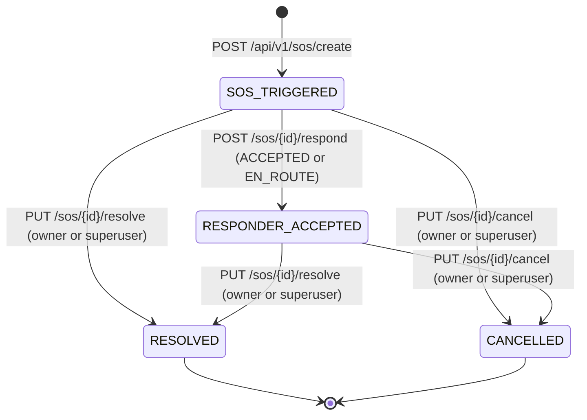

# System Design

This document explains the internal algorithms, state machines, concurrency controls, and resilience mechanisms implemented in NearHelp AI.

---

## 1. Smart SOS Engine & Idempotent Creation

Source: [`backend/app/services/sos_service.py`](backend/app/services/sos_service.py), [`android/app/src/main/java/com/example/nearhelp/ui/incident/IncidentViewModel.kt`](android/app/src/main/java/com/example/nearhelp/ui/incident/IncidentViewModel.kt)

### 1.1 Two-Layer Idempotency
Emergency mobile networks drop connections frequently. NearHelp protects `POST /api/v1/sos/create` against duplicate incidents in two places:
1. **HTTP Middleware (`IdempotencyMiddleware`):** In [`backend/app/core/middleware.py`](backend/app/core/middleware.py), any `POST`/`PUT`/`PATCH` with an `Idempotency-Key` (or `X-Idempotency-Key`) header hashes `method + path + authorization + key + request_body` with SHA-256 and caches responses with `status_code < 500` in Redis (or `_in_memory_idempotency`) for 24 hours (`86400s`), replaying them with header `X-Idempotent-Replay: true`.
2. **Database-Backed Deterministic UUIDv5 (`SOSService.create_sos_event`):** Even if Redis restarts or clears, `SOSService` computes:
   - `fingerprint = sha256(req.model_dump_json())`
   - `event_id = uuid5(NAMESPACE_URL, f"nearhelp:sos:{user.id if user else 'guest'}:{idempotency_key}")`
   If an `SOSEvent` with `event_id` already exists:
   - Matching fingerprint -> returns existing incident details (`SOSCreateResponse`).
   - Mismatched fingerprint -> raises HTTP `409 Conflict`.
   - Concurrent race (`IntegrityError` on `commit()`) -> rolls back and re-checks the existing row.

> **Important Limitation:** Replaying an existing incident returns its saved state but **does not re-run FCM notification fan-out** if the original process crashed mid-loop after `db.commit()`.

### 1.2 Synchronous AI Triage Call
Before persisting `SOSEvent`, `SOSService.create_sos_event` awaits `ai_client.predict_severity(severity_req)`. Note that `sos_service.py` passes `crisis_type`, `symptoms`, and `photo_url` into `backend/app/schemas/ai.py`'s `SeverityRequest`, which actually expects `emergency_type` and `detected_symptoms`—so `crisis_type`, `symptoms`, and `photo_url` are currently ignored by Pydantic (see [KNOWN_ISSUES.md](KNOWN_ISSUES.md)).

### 1.3 Incident Lifecycle State Machine

- **Row Locking & Double-Reward Guard:** Both `resolve_sos` and `cancel_sos` acquire a row lock via `.with_for_update()`. `resolve_sos` rejects already-ended incidents with HTTP `409 Conflict`, preventing duplicate trust-score increments (`+3.0` base + `+2.0` if `feedback_score >= 4.0`, capped at `100.0`).
- **Ownership Boundary:** Only `broadcaster_id == actor.id` or `actor.is_superuser` may resolve or cancel. Explicitly anonymous incidents (`is_anonymous=True`) store `broadcaster_id = None`, meaning only a superuser can resolve/cancel them via API.

---

## 2. Geospatial Dispatch & Responder Ranking

Source: [`backend/app/services/geo_service.py`](backend/app/services/geo_service.py), [`backend/app/services/ranking_service.py`](backend/app/services/ranking_service.py)

### 2.1 Availability Eligibility
`GeoService.is_available(user)` requires:
1. `user.device_info["available"]` is truthy.
2. `user.device_info["location_updated_at"]` is an ISO timestamp less than **900 seconds (15 minutes)** old.

On Android, `IncidentViewModel` rejects GPS fixes older than **120 seconds (2 minutes)** via `usableLocation(...)` and throttles `PUT /api/v1/users/me/location` updates to every 15 seconds unless availability toggles.

### 2.2 Spatial Query Strategy
- **PostgreSQL + PostGIS:** Executes native SQL inside a nested savepoint (`async with db.begin_nested()`):
  - `ST_DWithin(location::geography, ST_SetSRID(ST_MakePoint(:lon, :lat), 4326)::geography, :radius_meters)`
  - `ST_Distance(...)` ordered ascending.
- **SQLite / Fallback:** If the dialect is not `postgresql` or the spatial query fails, `GeoService` loads active users and filters in Python using the Haversine formula (`R = 6,371,000 m`).

### 2.3 Composite Weighted Ranking Formula

For each eligible candidate within the search radius:

$$
\text{Score} = w_1 \cdot D + w_2 \cdot S + w_3 \cdot R
$$

| Component | Default Weight | Formula & Range | Source |
| :--- | :--- | :--- | :--- |
| **Distance ($D$)** | `0.40` | $\max(0, \min(1, 1 - \text{distance\_m} / \text{max\_radius\_m}))$ | `RankingService.compute_distance_score` |
| **Skill Match ($S$)** | `0.35` | $\min(1.20, \frac{|\text{user\_skills} \cap \text{required}|}{|\text{required}|} + \text{bonus})$, where $\text{bonus} = 0.20$ if any matched skill is verified or present in `user.badges`; returns `0.5` if `required_skills` is empty | `RankingService.compute_skill_score` |
| **Reliability ($R$)** | `0.25` | $\max(0, \min(1, \text{trust\_score} / 100.0))$ | `RankingService.compute_reliability_score` |

- **Severity-Scaled Fan-Out Cap (`target_limit`):**
  - Level `5` (Critical) -> Top **15** responders
  - Level `4` (High) -> Top **8** responders
  - Level `3` (Moderate) -> Top **5** responders
  - Level `2` (Low) -> Top **3** responders
  - Level `1` -> Top **2** responders

---

## 3. 3-Layer Escalation Protocol

Source: [`backend/app/services/sos_service.py`](backend/app/services/sos_service.py) (`escalate_sos`)

When `POST /api/v1/sos/{id}/escalate` is invoked with `elapsed_seconds` or `force_layer`:
- **Layer 1 (`30 <= elapsed < 45`):** Multiplies `current_radius_meters` by `2.0` (capped at `max_radius_meters = 5000.0m`).
- **Layer 1 (`45 <= elapsed < 60`):** Multiplies `current_radius_meters` by `3.0` (capped at `5000.0m`).
- **Layer 2 (`elapsed >= 60` or `force_layer == 2`):** Sets `escalation_layer = 2`, sets `auto_call_108_triggered = True`, expands radius to `5000.0m`. Recommended numbers: `101` (fire/gas_leak), `100` (crime), `108` (medical/default).
- **Layer 3 (`force_layer == 3`):** Sets `escalation_layer = 3` (Guided Self-Care AI Fallback).

If `new_radius > old_radius`, newly covered responders are ranked and notified via FCM. **Note:** No background scheduler invokes `escalate_sos` automatically.

---

## 4. Live Tracking, ETA, and WebSocket Room Design

Source: [`backend/app/api/tracking_ws.py`](backend/app/api/tracking_ws.py), [`backend/app/services/tracking_service.py`](backend/app/services/tracking_service.py), [`backend/app/services/eta_service.py`](backend/app/services/eta_service.py)

### 4.1 Role Assignment on Socket Connect
When a client connects to `/ws/tracking/{incident_id}?token=...`:
1. Missing `token` -> accepted as `role = "guest"` (read-only). Invalid non-empty `token` -> closed with code `1008`.
2. Valid JWT -> `victim` (`event.broadcaster_id == user_id`), `admin` (`user.is_superuser`), `responder` (has `SOSResponse` row for this incident), or `dispatcher` (authenticated non-participant).
3. Server immediately sends `connection_ack` followed by `tracking_snapshot` (containing active responders, closest AED within `10 km`, and closest hospital within `15 km`).

### 4.2 Telemetry Freshness & ETA Calculation
- **Newest-Wins Cache:** `TrackingService.build_tracking_snapshot` compares the timestamp of `TrackingService._live_telemetry_cache` against `user.device_info["last_updated"]` / `location_updated_at` so HTTP REST location updates supersede stale socket cache entries.
- **ETA (`ETAService.calculate_eta`):**
  - Uses Haversine distance multiplied by `URBAN_TORTUOSITY_FACTOR = 1.35`.
  - Default speeds: walking `1.25 m/s` (~4.5 km/h), bike `5.55 m/s` (~20 km/h), vehicle/ambulance `8.33 m/s` (~30 km/h), or live GPS `speed_mps` clamped to `[1.0, 28.0] m/s` when `> 0.8`.
  - **Auto-Arrival:** If `distance_meters <= 35.0` (`ARRIVAL_THRESHOLD_METERS`), `process_location_update` transitions `ACCEPTED`/`EN_ROUTE` responders to `ARRIVED`, sets `eta_formatted = "Arrived"`, and logs a `RESPONDER_ARRIVED` `TimelineEvent`.

---

## 5. Middleware: Rate Limiting & Presence

- **Auth Rate Limiting (`RateLimitMiddleware`):** Protects all `POST` requests whose URL path contains `"/auth/"`. Default limit: `30` requests per `60` seconds per `request.client.host`, backed by Redis sorted sets (`ZREMRANGEBYSCORE` / `ZADD` / `ZCARD`) or an in-memory timestamp list. Returns HTTP `429` with `Retry-After: 60`.
- **Presence Tracking (`presence_service.record_activity`):** Every authenticated HTTP request resolved by `get_current_user` or `get_optional_current_user` performs an `ON CONFLICT DO UPDATE` on `user_presence` throttled to once per **30 seconds** (`ONLINE_WINDOW_SECONDS = 300`).
