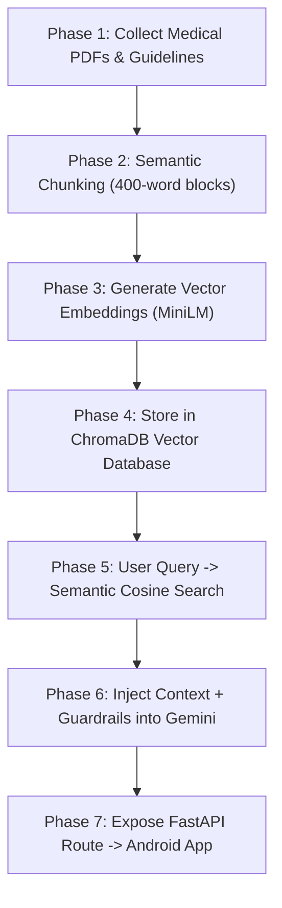

# NearHelp AI — Comprehensive RAG Implementation Roadmap
> **Target Audience**: Beginners to Retrieval-Augmented Generation (RAG) & Emergency System Developers  
> **Location in Repository**: `docs/RAG_IMPLEMENTATION_ROADMAP.md`  
> **Companion Existing Code**: [`ai_service/app/rag/`](../ai_service/app/rag/), [`data/protocols/`](../data/protocols/)  
> **Status**: Comprehensive Step-by-Step Blueprint  

---

## Table of Contents
1. [What is RAG? (The "Open-Book Exam" Mental Model)](#1-what-is-rag-the-open-book-exam-mental-model)
2. [Why RAG is Mandatory for Emergency Medical Apps](#2-why-rag-is-mandatory-for-emergency-medical-apps)
3. [Recommended Technology Stack & Services](#3-recommended-technology-stack--services)
4. [The 7-Phase Step-by-Step Implementation Roadmap](#4-the-7-phase-step-by-step-implementation-roadmap)
   - [Phase 1: Document Collection & Preparation](#phase-1-document-collection--preparation)
   - [Phase 2: Semantic Chunking (Splitting Protocols)](#phase-2-semantic-chunking-splitting-protocols)
   - [Phase 3: Vector Embeddings (Converting Text to Numbers)](#phase-3-vector-embeddings-converting-text-to-numbers)
   - [Phase 4: Vector Storage (Setting up ChromaDB)](#phase-4-vector-storage-setting-up-chromadb)
   - [Phase 5: Semantic Retrieval (Finding Relevant Help)](#phase-5-semantic-retrieval-finding-relevant-help)
   - [Phase 6: Augmented Prompt Generation & Guardrails](#phase-6-augmented-prompt-generation--guardrails)
   - [Phase 7: End-to-End API Integration & Mobile Hookup](#phase-7-end-to-end-api-integration--mobile-hookup)
5. [60-Second Hands-On Prototype (Run It Locally)](#5-60-second-hands-on-prototype-run-it-locally)
6. [Mapping to Existing NearHelp Codebase](#6-mapping-to-existing-nearhelp-codebase)
7. [Academic Defense & Viva Q&A Guide](#7-academic-defense--viva-qa-guide)

---

## 1. What is RAG? (The "Open-Book Exam" Mental Model)

If you have never used RAG before, think of it using a simple university analogy:

* **Standard LLM (Gemini / ChatGPT alone) = A Closed-Book Exam**:
  The AI relies entirely on what it memorized during pre-training months or years ago. When panicked, or asked a very specific or rare medical question, it might guess, misremember, or invent details (**hallucination**). In an emergency, hallucinating a medicine dosage or asking a user to give water to an unconscious person can be fatal.

* **RAG (Retrieval-Augmented Generation) = An Open-Book Exam**:
  1. The user asks: *"A man collapsed and is gasping, what do I do?"*
  2. Before answering, the system opens a verified medical reference textbook (WHO / Red Cross / American Heart Association) sitting on its desk.
  3. It searches for the exact page covering "Adult CPR and Agonal Breathing".
  4. It hands that exact verified page to Gemini and instructs: *"Answer the user's question using ONLY the facts written on this page. Cite the source, and do NOT guess."*
  5. Gemini formats a calm, clear, step-by-step response based 100% on that authoritative page.

```
┌────────────────┐      ┌─────────────────────────┐      ┌──────────────────┐
│  User Emergency│ ───> │  1. Semantic Retriever  │ ───> │ 2. Vector DB     │
│  Query         │      │     (Search Query)      │      │    (ChromaDB)    │
└────────────────┘      └─────────────────────────┘      └─────────┬────────┘
                                                                   │ Returns Top-K
                                                                   │ Clinical Chunks
                                                                   ▼
┌────────────────┐      ┌─────────────────────────┐      ┌──────────────────┐
│ Verified Safe  │ <─── │ 4. Google Gemini Flash  │ <─── │ 3. Context-Packed│
│ Response       │      │    (Guided by Context)  │      │    Prompt + Rules│
└────────────────┘      └─────────────────────────┘      └──────────────────┘
```

---

## 2. Why RAG is Mandatory for Emergency Medical Apps

In consumer chatbots, a small hallucination is harmless. In **NearHelp**, medical errors have direct legal and clinical consequences:
1. **Zero Hallucinations**: You cannot allow the AI to invent first-aid advice (e.g., cutting a snakebite, giving water to a seizure victim).
2. **Clinical Authority & Citation**: Under India's **Good Samaritan Law (Section 134A Motor Vehicles Act)**, community responders are protected when following recognized protocols. The app must cite recognized authorities (e.g., *"According to AHA 2020 BLS Guidelines..."*).
3. **No Retraining Required**: When medical guidelines change (e.g., WHO updates burn treatment), you don't retrain the AI; you simply update the text document in your vector store.

---

## 3. Recommended Technology Stack & Services

For a modern, production-grade RAG system in Python that connects cleanly to Android:

| Component | Recommended Tool | Why It's Best for Beginners & NearHelp |
| :--- | :--- | :--- |
| **LLM (Generator)** | **Google Gemini 2.0 / 2.5 Flash** | Ultra-low latency (~400ms), huge context window, officially supported via `google-genai` SDK, free tier available. |
| **Vector Database** | **ChromaDB** | Embedded, lightweight, written in pure Python. Runs in-memory or persists to a local folder (`.chroma/`). No external Docker or AWS database needed. |
| **Embedding Model** | **Sentence-Transformers** (`all-MiniLM-L6-v2`) or **Gemini Embeddings** (`text-embedding-004`) | `all-MiniLM-L6-v2` runs locally on CPU in `< 10ms` (384-dimensional vectors, zero API cost). `text-embedding-004` uses Google's API. |
| **Document Parser** | **PyPDF / pdfplumber** + **JSON** | Extracts text and tables from official WHO/Red Cross guideline PDFs. |
| **API Framework** | **FastAPI** | High-performance Python async backend already running in your `ai_service` on port `8001`. |
| **Safety Guardrails**| **Deterministic Regex / Guardrail Engine** | Catches dangerous medical contraindications before the LLM can generate them. |

---

## 4. The 7-Phase Step-by-Step Implementation Roadmap



---

### Phase 1: Document Collection & Preparation
**Goal**: Assemble authoritative medical first-aid text into structured files.

1. **Sources to Use**:
   - **American Heart Association (AHA)**: CPR & ECC Basic Life Support (BLS).
   - **World Health Organization (WHO)**: Basic Emergency Care (BEC) manual.
   - **International Federation of Red Cross (IFRC)**: International First Aid guidelines.
   - **NDMA India**: National Disaster Management Authority emergency SOPs.
2. **Storage Location**: Save them in your repository at `data/protocols/` (already present: [`data/protocols/who_first_aid_guidelines.json`](../data/protocols/who_first_aid_guidelines.json), [`aha_cpr_bls.md`](../data/protocols/aha_cpr_bls.md)).
3. **Format**: Store them as Markdown (`.md`) or clean JSON (`.json`) with distinct fields:
   - `condition_id`: e.g., `"cardiac_arrest"`, `"severe_bleeding"`, `"snakebite"`
   - `authority`: e.g., `"American Heart Association 2020"`
   - `steps`: Step 1, Step 2, Step 3...
   - `contraindications`: What NEVER to do (e.g., *"Do not remove impaled knife"*).

---

### Phase 2: Semantic Chunking (Splitting Protocols)
**Goal**: Break large documents into small, logical paragraphs that fit neatly into an AI prompt.

* **Why Chunk?**: If you send an entire 200-page WHO PDF to an LLM for every search, it is too slow, expensive, and dilutes the answer.
* **The Rule of Thumb**:
  - Chunk Size: **300 to 500 tokens** (about 1 to 2 paragraphs or 1 clinical procedure).
  - Chunk Overlap: **50 tokens** (prevents a critical sentence from getting cut in half).
* **Metadata Attachment**: Every chunk MUST carry metadata:
  ```json
  {
    "chunk_id": "cpr_step_01",
    "condition": "cardiac_arrest",
    "authority": "AHA Guidelines",
    "text": "Check responsiveness and pulse for no more than 10 seconds. If unresponsive and not breathing normally, begin high-quality chest compressions at 100-120 BPM...",
    "contraindication": "Do not delay compressions to perform pulse checks."
  }
  ```
*(This is already designed in [`ai_service/app/rag/chunker.py`](../ai_service/app/rag/chunker.py).)*

---

### Phase 3: Vector Embeddings (Converting Text to Numbers)
**Goal**: Transform sentences into mathematical vectors (arrays of floating-point numbers) so the computer can understand meaning.

* **How It Works**:
  Computers cannot understand the concept of "heart attack". An embedding model converts the sentence into a coordinate in a 384-dimensional space:
  - `"Man collapsed clutching chest"` $\rightarrow$ `[0.231, -0.412, 0.891, ...]`
  - `"Cardiac arrest unresponsive"` $\rightarrow$ `[0.228, -0.405, 0.887, ...]`
  - `"Recipe for chocolate cake"` $\rightarrow$ `[-0.781, 0.114, -0.021, ...]`
* Notice how the first two vectors have almost identical numbers because their **meaning** is similar, even though they use completely different words!
* **Recommended Library**:
  ```python
  from sentence_transformers import SentenceTransformer
  model = SentenceTransformer('all-MiniLM-L6-v2')
  vector = model.encode("Patient is having severe chest pain")
  ```

---

### Phase 4: Vector Storage (Setting up ChromaDB)
**Goal**: Save the vectors into a specialized database that can search millions of vectors in milliseconds.

1. **Install ChromaDB**:
   ```bash
   pip install chromadb
   ```
2. **Initialize Persistent ChromaDB Client**:
   ```python
   import chromadb
   # Saves data locally inside the .chroma folder
   client = chromadb.PersistentClient(path="./data/chroma_db")
   collection = client.get_or_create_collection(
       name="emergency_protocols",
       metadata={"hnsw:space": "cosine"} # Use cosine similarity for angle/meaning match
   )
   ```
3. **Ingest Chunks & Embeddings**:
   ```python
   collection.add(
       ids=["chunk_1", "chunk_2"],
       documents=[
           "For severe arterial bleeding, apply direct continuous pressure with a sterile dressing. Do not remove dressing if soaked; add more pads on top.",
           "For snakebites, immobilize the limb below heart level. Never cut or suck venom."
       ],
       metadatas=[
           {"source": "WHO", "condition": "bleeding"},
           {"source": "Red Cross", "condition": "snakebite"}
       ]
   )
   ```

---

### Phase 5: Semantic Retrieval (Finding Relevant Help)
**Goal**: When a user types an emergency query, find the top 2–3 most relevant protocol chunks.

```python
user_query = "His leg is bleeding heavily from an open cut"

# ChromaDB automatically embeds the query and runs Cosine Similarity Search:
results = collection.query(
    query_texts=[user_query],
    n_results=2 # Return top 2 matching chunks
)

retrieved_text = results['documents'][0]
retrieved_sources = results['metadatas'][0]
```

---

### Phase 6: Augmented Prompt Generation & Guardrails
**Goal**: Construct the prompt that instructs Google Gemini to answer using the retrieved context.

1. **The System Prompt Template**:
   ```python
   prompt = f"""
   You are NearHelp AI, an emergency first-aid co-pilot operating under India's Good Samaritan Law.
   A panicked user is facing an emergency. Give direct, step-by-step first-aid guidance.
   
   CRITICAL CLINICAL RULES:
   1. Base your instructions ONLY on the verified medical protocols provided below.
   2. NEVER prescribe prescription medications or tell the user to make surgical cuts.
   3. Always emphasize calling 108/112 for professional EMS immediately.
   4. Highlight any contraindications (what NOT to do) in bold.
   
   VERIFIED MEDICAL CONTEXT:
   {retrieved_text}
   
   USER QUERY:
   {user_query}
   
   SAFE EMERGENCY GUIDANCE:
   """
   ```

2. **Call Google Gemini**:
   ```python
   from google import genai
   client = genai.Client(api_key="YOUR_GEMINI_API_KEY")
   response = client.models.generate_content(
       model="gemini-2.5-flash",
       contents=prompt
   )
   safe_first_aid_answer = response.text
   ```

3. **Contraindication Guardrail Filter**:
   Run the generated text through [`guardrails.py`](../ai_service/app/rag/guardrails.py) to check for prohibited keywords (e.g. "cut the wound", "give water to unconscious", "induce vomiting") before returning to the user.

---

### Phase 7: End-to-End API Integration & Mobile Hookup
**Goal**: Expose this RAG pipeline over HTTP so the Android app can call it.

1. **Expose FastAPI Endpoint** (`ai_service/app/api/rag.py`):
   ```python
   @router.post("/chat")
   async def rag_emergency_chat(request: EmergencyChatRequest):
       # 1. Retrieve top-k chunks from ChromaDB
       chunks = rag_retriever.search(request.text, top_k=2)
       # 2. Generate with Gemini
       response = await gemini_client.generate(request.text, context=chunks)
       # 3. Return JSON with citations
       return {
           "reply": response.text,
           "citations": [c.source for c in chunks],
           "contraindications": response.contraindications
       }
   ```

2. **Android Client Call** (`android/.../AiAgentRepository.kt`):
   Replace the temporary direct Gemini call with a call to your backend `/api/v1/ai/chat` endpoint. If the backend fails or cellular drops, automatically fall back to your local 18-condition emergency engine.

---

## 5. 60-Second Hands-On Prototype (Run It Locally)

Want to see RAG work on your computer right now without setting up databases? Create a file called `rag_quickstart.py` and run it:

```python
"""NearHelp AI — Minimal 60-Second RAG Prototype."""
import chromadb

# 1. Initialize local in-memory ChromaDB
client = chromadb.Client()
collection = client.create_collection(name="emergency_first_aid")

# 2. Ingest sample WHO / AHA medical protocols
collection.add(
    ids=["cardiac_cpr", "snakebite_bls"],
    documents=[
        "CARDIAC ARREST (AHA): Check responsiveness. If no breathing, begin CPR: 30 compressions followed by 2 breaths. Compress hard and fast in center of chest at 100-120 BPM. Push at least 2 inches deep. Do not stop until AED arrives.",
        "SNAKEBITE (WHO): Keep patient calm and completely still. Immobilize the bitten limb with a splint below heart level. Remove tight jewelry. DO NOT apply tourniquets. DO NOT cut the wound. DO NOT attempt to suck venom. Transport immediately to hospital with antivenom."
    ],
    metadatas=[{"source": "AHA Guidelines 2020"}, {"source": "WHO Guidelines 2016"}]
)

# 3. Simulate user query
query = "My friend was bitten by a cobra on his ankle! Should I cut it to bleed the poison?"
print(f"User Query: {query}\n")

# 4. Retrieve most relevant protocol
results = collection.query(query_texts=[query], n_results=1)
retrieved_protocol = results['documents'][0][0]
source = results['metadatas'][0][0]['source']

print(f"--- RETRIEVED GROUND TRUTH ({source}) ---")
print(retrieved_protocol)
print("------------------------------------------\n")

# 5. Build prompt for Gemini / LLM
augmented_prompt = f"""
Using ONLY the following verified medical context, answer the user's emergency question.
Warn them immediately about any dangerous actions they should NOT take.

Context: {retrieved_protocol}
User Query: {query}
"""

print("--- PROMPT SENT TO GEMINI ---")
print(augmented_prompt)
```

---

## 6. Mapping to Existing NearHelp Codebase

Your project already has the core building blocks drafted! You do **not** need to start from scratch:

| RAG Component | Existing File in NearHelp | What it Does |
| :--- | :--- | :--- |
| **Raw Guidelines** | [`data/protocols/`](../data/protocols/) | Contains WHO, AHA, Red Cross, and AIIMS first-aid protocols in JSON and Markdown. |
| **Document Chunker** | [`ai_service/app/rag/chunker.py`](../ai_service/app/rag/chunker.py) | Splits JSON/Markdown into `ProtocolChunk` objects with step numbers and warning notes. |
| **Vector Store** | [`ai_service/app/rag/store.py`](../ai_service/app/rag/store.py) | Wraps `chromadb.PersistentClient`, managing the collection and embeddings. |
| **Semantic Retriever**| [`ai_service/app/rag/retriever.py`](../ai_service/app/rag/retriever.py) | Performs hybrid search and re-ranking using cosine similarity. |
| **Clinical Guardrails**| [`ai_service/app/rag/guardrails.py`](../ai_service/app/rag/guardrails.py) | Blocks surgical and medical contraindications (forbidden incisions, forbidden fluids). |
| **REST Endpoints** | [`ai_service/app/api/rag.py`](../ai_service/app/api/rag.py) | FastAPI endpoints (`POST /api/rag/search`, `POST /api/rag/query`). |

---

## 7. Academic Defense & Viva Q&A Guide

When external examiners ask about your RAG implementation during your project defense, use these precise technical answers:

#### Q1: "What is the difference between Fine-Tuning an LLM and using RAG?"
* **Answer**:
  * **Fine-Tuning** updates the internal neural weights of the model with new training data. It is expensive, slow, prone to catastrophic forgetting, and does *not* eliminate hallucinations or provide verifiable citation links.
  * **RAG** keeps the foundational model frozen and supplies accurate, timestamped factual context dynamically in the prompt. It is deterministic, instantaneous to update, and provides legal traceability to WHO/AHA guidelines under India's Good Samaritan Law.

#### Q2: "How do you handle vector retrieval latency in a time-critical emergency?"
* **Answer**:
  * We implement a **decoupled, two-tier fallback architecture**:
    1. The core SOS trigger path never waits for vector retrieval (dispatches in `< 500ms`).
    2. Vector embeddings are generated using lightweight CPU models (`all-MiniLM-L6-v2` at 384 dimensions) giving retrieval times `< 15ms`.
    3. If network latency spikes (>2000ms), the Android client instantly falls back to its pre-compiled local 18-condition emergency engine without leaving the user waiting.

#### Q3: "What similarity metric does your vector database use and why?"
* **Answer**:
  * We use **Cosine Similarity** (via HNSW indexing in ChromaDB). Cosine similarity measures the angle between the normalized query vector and document vectors rather than Euclidean distance, making it independent of document length and focusing purely on semantic intent.

