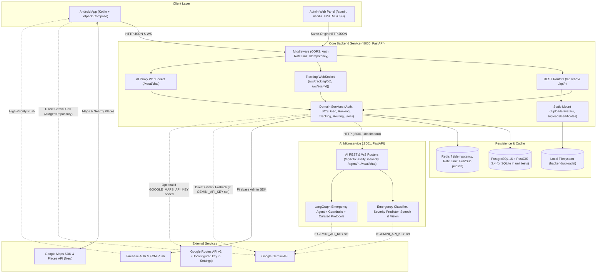

# 1. Overall System Architecture

This diagram depicts the actual services, clients, data stores, and external integrations present in the repository.

## Key Source References

- Backend entry point: [`backend/app/main.py`](../../../backend/app/main.py)
- AI Service entry point: [`ai_service/app/main.py`](../../../ai_service/app/main.py)
- Compose stack: [`docker-compose.yml`](../../../docker-compose.yml)
- Android networking: [`RetrofitClient.kt`](../../../android/app/src/main/java/com/example/nearhelp/data/api/RetrofitClient.kt)
