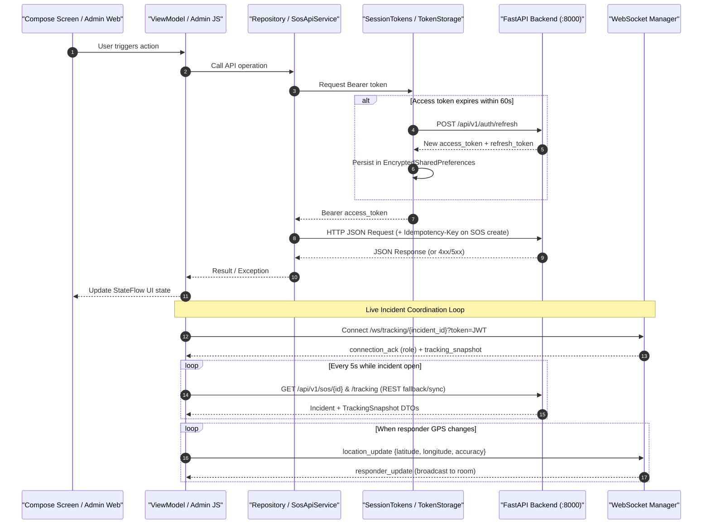

# 2. Frontend-Backend Communication

This diagram shows how the Android app and Admin Web UI communicate with the FastAPI backend over HTTP/REST and WebSockets, including token refresh and polling fallbacks.

## Key Observations from Code

- **No global OkHttp auth interceptor**: Token refresh is handled explicitly by [`SessionTokens.kt`](../../../android/app/src/main/java/com/example/nearhelp/data/api/SessionTokens.kt) on callers that invoke `SessionTokens.bearer()`. Note that `UserRepository` reads `tokenStorage.getAccessToken()` directly without calling `SessionTokens.bearer()`.
- **Admin Web session storage**: [`backend/app/admin_web/app.js`](../../../backend/app/admin_web/app.js) stores `accessToken` and `refreshToken` strictly in page memory (`let accessToken = ''`) and automatically retries once on HTTP 401 via `/api/v1/auth/refresh`.
- **Direct incident service call**: [`IncidentViewModel.kt`](../../../android/app/src/main/java/com/example/nearhelp/ui/incident/IncidentViewModel.kt) delegates to [`AndroidIncidentRepository`](../../../android/app/src/main/java/com/example/nearhelp/data/repository/IncidentRepository.kt) (which wraps `SosApiService`) and [`LiveTrackingWebSocketClient.kt`](../../../android/app/src/main/java/com/example/nearhelp/data/api/ws/LiveTrackingWebSocketClient.kt).
