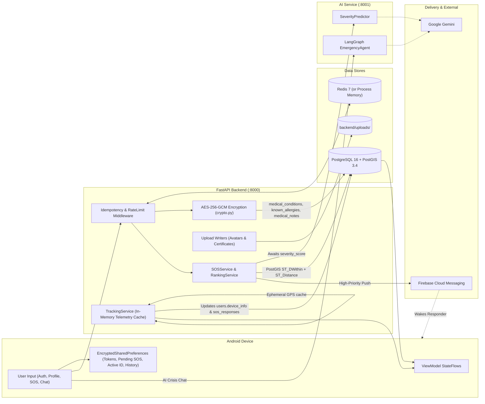

# 3. Application Data Flow

This diagram traces user data across Android local storage, backend PostgreSQL/PostGIS, Redis, local uploads, AI services, and external APIs.

## Key Source References

- Encryption helper: [`backend/app/core/crypto.py`](../../backend/app/core/crypto.py)
- Middleware cache: [`backend/app/core/middleware.py`](../../backend/app/core/middleware.py)
- SOS lifecycle: [`backend/app/services/sos_service.py`](../../backend/app/services/sos_service.py)
- Live tracking state: [`backend/app/services/tracking_service.py`](../../backend/app/services/tracking_service.py)
