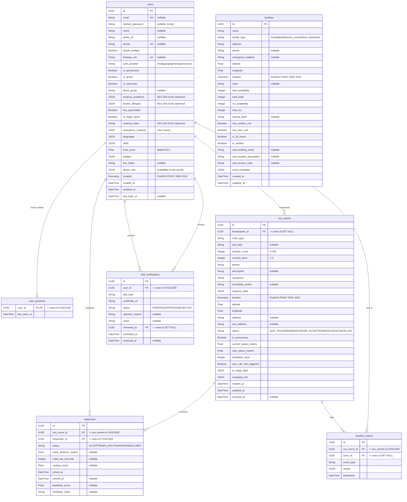

# 4. Database Entity Relationship Diagram

This ERD reflects the exact SQLAlchemy models defined in [`backend/app/models/`](../../backend/app/models/). Note that `messages` and `ai_summaries` tables shown in earlier planning docs do not exist; participant chat is persisted in `timeline_events` and AI triage output is stored in `sos_events.ai_triage_data`.

