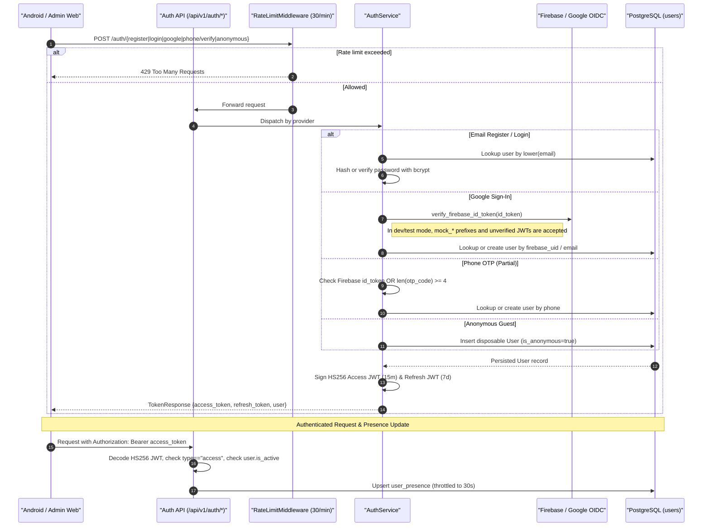

# 5. Authentication Workflow

NearHelp AI supports four authentication branches that all converge on backend-issued HS256 JWT access and refresh tokens.

## Key Source References

- Routes: [`backend/app/api/auth.py`](../../backend/app/api/auth.py)
- Service: [`backend/app/services/auth_service.py`](../../backend/app/services/auth_service.py)
- Firebase verification & dev fallbacks: [`backend/app/services/firebase_service.py`](../../backend/app/services/firebase_service.py)
- Token signing & bcrypt: [`backend/app/core/security.py`](../../backend/app/core/security.py)
- Request dependencies & presence: [`backend/app/core/dependencies.py`](../../backend/app/core/dependencies.py), [`backend/app/services/presence_service.py`](../../backend/app/services/presence_service.py)
