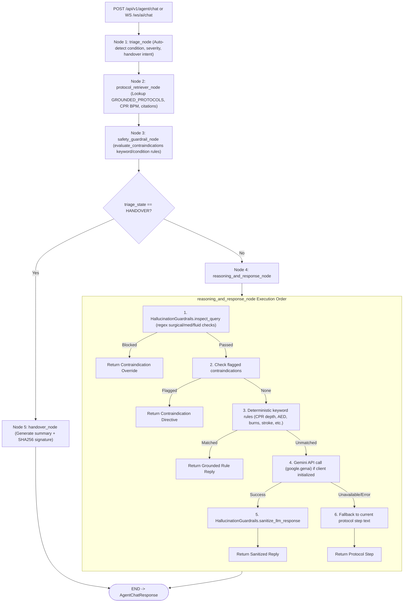
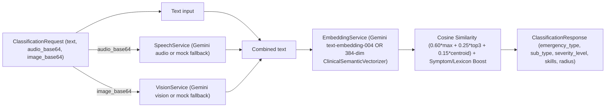

# 7. AI Processing Pipeline

NearHelp AI implements a multi-tier AI architecture across the **Android client**, **Backend proxy (`AIClient`)**, and **AI microservice (`ai_service`)**.

## 7.1 LangGraph Emergency Agent Pipeline (`ai_service`)

## 7.2 Three-Tier Request Routing & Fallback Chain (Android Chat)

```mermaid
flowchart LR
    Mobile["Android AiCrisisAssistantViewModel"] --> Repo["AiAgentRepository.chatWithAgent"]
    Repo -->|"1. Optional user key in TokenStorage"| DirectGemini["Direct OkHttp to Gemini REST API (Bypasses LangGraph!)"]
    DirectGemini -->|"Success"| Reply["Render AgentChatResponseDto"]
    DirectGemini -->|"Failure"| BackendProxy["2. POST /api/v1/ai/agent/chat"]
    BackendProxy --> AISvc["3. HTTP to ai_service:8001/api/v1/agent/chat"]
    AISvc -->|"Success"| BackendCheck{"Generic triage reply?"}
    AISvc -->|"Timeout / Offline"| BackendFallback["Backend AIClient._local_fallback_agent_chat (Direct Gemini or 27-condition rules)"]
    BackendFallback --> BackendCheck
    BackendCheck -->|"No"| Reply
    BackendCheck -->|"Yes (non-cardiac)"| LocalFallback["4. Android Local Knowledge Base Fallback"]
    LocalFallback --> Reply
```

## 7.3 Multimodal Classification & Severity Pipeline (`ai_service`)

