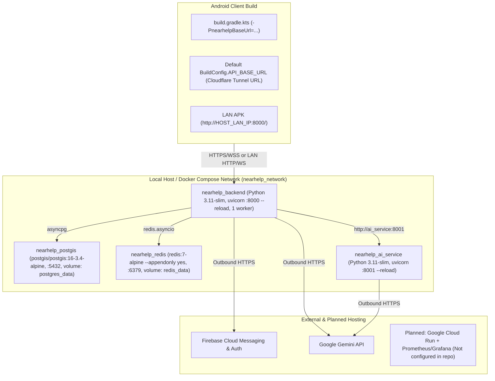

# 8. Deployment Architecture

This diagram shows the **implemented local Docker Compose topology** alongside **LAN device testing** and **planned/partially configured cloud components**.

## Deployment Notes & Verified Boundaries

- **Single-worker constraint**: `ws_manager` in [`backend/app/core/websocket_manager.py`](../../backend/app/core/websocket_manager.py) stores WebSocket rooms in process memory and `TrackingService._live_telemetry_cache` is process-local. Redis Pub/Sub publishes messages (`channel:tracking:{incident_id}`), but no subscriber loop is implemented. Multi-worker deployments will miss socket broadcasts across workers.
- **Port exposure**: `docker-compose.yml` exposes `:8001` (`ai_service`), `:5432` (`db`), and `:6379` (`redis`) directly to the host, and both Dockerfiles start `uvicorn` with `--reload` (development mode).
- **Android default endpoint**: [`android/app/build.gradle.kts`](../../android/app/build.gradle.kts) defaults `API_BASE_URL` to a `trycloudflare.com` tunnel URL unless overridden via `-PnearhelpBaseUrl=...` or changed in-app via the Login screen's Server Settings dialog.
- **Unimplemented planned infra**: `docs/architecture.md` references Google Cloud Run, Prometheus, Grafana, Sentry, and a Next.js `admin_dashboard/`. None of those manifests or directories exist in this repository (the actual admin panel is served statically by FastAPI at `/admin`).
