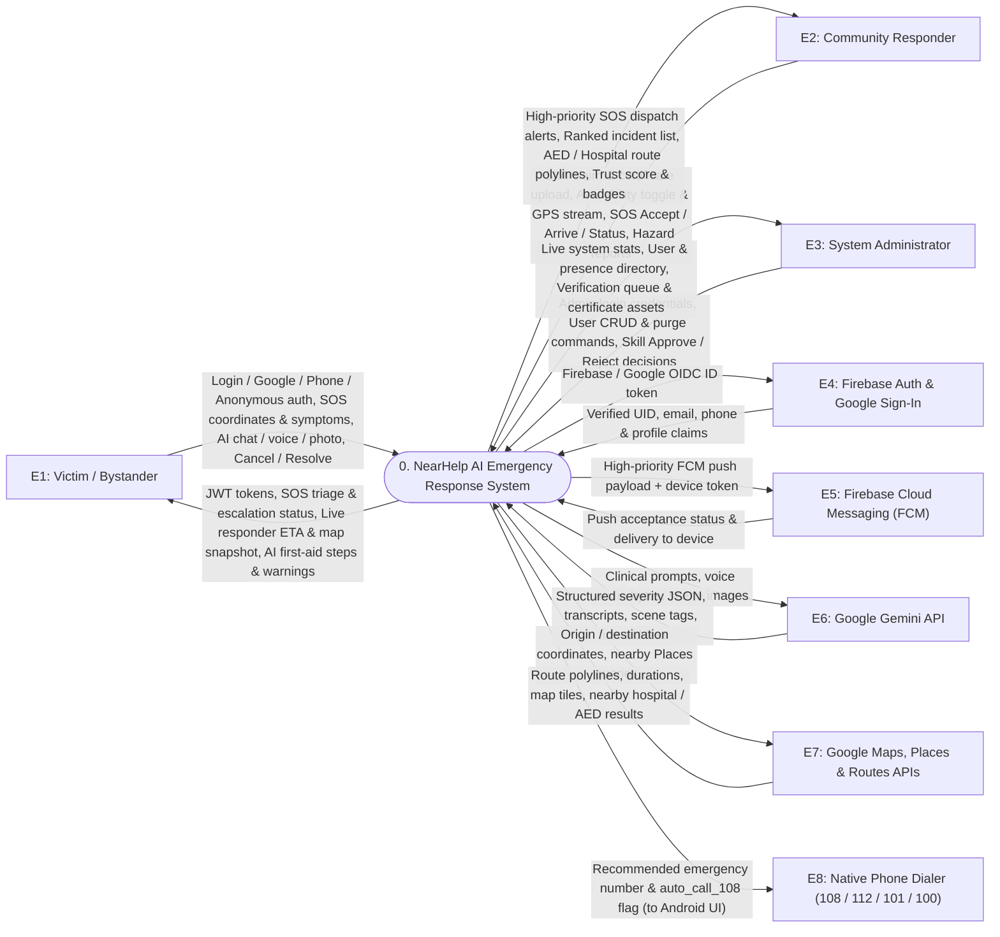

# DFD Level 0 — Context Diagram

> **Related Documentation:** [ARCHITECTURE.md](../../ARCHITECTURE.md) | [DATABASE.md](../../DATABASE.md) | [API_REFERENCE.md](../../API_REFERENCE.md) | [DFD Level 1](dfd-level-1-system.md)

The Level 0 Context Diagram treats the entire **NearHelp AI** platform (Android app, FastAPI Backend `:8000`, Admin Web console `/admin`, and FastAPI AI Microservice `:8001`, along with its internal databases) as **one single system boundary (`0. NearHelp AI Emergency Response System`)**. It shows every person or external service that sends information into NearHelp and what NearHelp sends back to them.

---

## 1. Context Diagram

---

## 2. Beginner-Friendly Walkthrough

Think of the circle in the middle as a **black box** representing everything NearHelp owns and runs:

1. **People on their phones (`E1`, `E2`)** press SOS, talk to the AI assistant, or accept nearby emergencies to help.
2. **An Admin in a web browser (`E3`)** checks who is online, manages accounts, and verifies responder certificates (such as CPR or medical licenses).
3. **NearHelp talks to Google and Firebase (`E4`–`E7`)** when it needs to check a Google login, push an emergency wake-up alert to a phone, ask Gemini to analyze text/voice/photos, or calculate maps and routes.
4. **No direct server-to-ambulance link exists (`E8`):** When an emergency escalates past 60 seconds or hits critical severity, the backend sends a recommendation flag (`auto_call_108_triggered` and `recommended_emergency_number`), and the Android app opens the phone's built-in dialer so the user can place the call.

---

## 3. External Entities Reference

| Entity ID | External Entity | Role & Interaction Summary | Verification / Source Status |
| :--- | :--- | :--- | :--- |
| `E1` | **Victim / Bystander** | Uses the Android app (`android/`) to authenticate, trigger 1-tap or detailed SOS alerts, stream/receive tracking updates, chat with the AI crisis assistant, and resolve or cancel their SOS. | Implemented in [Navigation.kt](../../android/app/src/main/java/com/example/nearhelp/Navigation.kt), [IncidentViewModel.kt](../../android/app/src/main/java/com/example/nearhelp/ui/incident/IncidentViewModel.kt). |
| `E2` | **Community Responder** | Uses the Android app to upload skill certificates, toggle availability, receive dispatch alerts, accept incidents, stream live GPS coordinates, view AED/hospital routes, and log arrival/handover. | Implemented across [UserApiService.kt](../../android/app/src/main/java/com/example/nearhelp/data/api/UserApiService.kt), [SosApiService.kt](../../android/app/src/main/java/com/example/nearhelp/data/api/SosApiService.kt), [LiveTrackingWebSocketClient.kt](../../android/app/src/main/java/com/example/nearhelp/data/api/ws/LiveTrackingWebSocketClient.kt). |
| `E3` | **System Administrator** | Uses the same-origin HTML/JS console served at `/admin` ([index.html](../../backend/app/admin_web/index.html), [app.js](../../backend/app/admin_web/app.js)) to monitor KPIs, search/manage users, purge anonymous demo users, and approve/reject skill claims. | Implemented (`is_superuser=True` required via [dependencies.py](../../backend/app/core/dependencies.py)). |
| `E4` | **Firebase Auth & Google Sign-In** | Verifies Google OIDC tokens and Firebase ID tokens submitted during `/api/v1/auth/google` and `/api/v1/auth/phone/verify`. | Implemented in [firebase_service.py](../../backend/app/services/firebase_service.py) and [GoogleAuthentication.kt](../../android/app/src/main/java/com/example/nearhelp/ui/auth/GoogleAuthentication.kt). In `development`/`test`/`testing`, mock/unverified token fallbacks are active. |
| `E5` | **Firebase Cloud Messaging (FCM)** | Delivers high-priority Android data pushes when responders are matched to an SOS, when a responder accepts, or when a skill verification is approved/rejected. | Implemented in [notification_service.py](../../backend/app/services/notification_service.py) (`messaging.send`) and [NearHelpMessagingService.kt](../../android/app/src/main/java/com/example/nearhelp/notifications/NearHelpMessagingService.kt). Requires valid Firebase service account credentials + client `google-services.json`. |
| `E6` | **Google Gemini API** | Used for severity JSON scoring (`severity_predictor.py`), voice transcription (`speech_service.py`), scene image analysis (`vision_service.py`), conversational guidance (`gemini_agent.py` and backend fallback), and direct Android chat (`AiAgentRepository.kt`). | Implemented; all server paths fall back to deterministic rules when `GEMINI_API_KEY` is unset or API calls fail. |
| `E7` | **Google Maps, Places & Routes APIs** | Android displays Maps SDK maps and searches nearby hospitals/pharmacies via Places SDK ([GoogleNearbyPlacesRepository.kt](../../android/app/src/main/java/com/example/nearhelp/data/places/GoogleNearbyPlacesRepository.kt)). Backend optionally queries `routes.googleapis.com/directions/v2:computeRoutes` ([routing_service.py](../../backend/app/services/routing_service.py)). | Partially verified: backend `Settings` ([config.py](../../backend/app/core/config.py)) does not declare `GOOGLE_MAPS_API_KEY`, so server routing falls back to Haversine/interpolated Kolkata Sector V paths unless injected via environment/attribute. |
| `E8` | **Native Phone Dialer (108 / 112 / 101 / 100)** | No server-side telephony/SIP gateway exists. System outputs `recommended_emergency_number` and `auto_call_108_triggered` to the client, which opens Android's local `ACTION_DIAL` dialer. | Client-side recommendation only (verified in [sos_service.py](../../backend/app/services/sos_service.py#L71-L88)). |

---

## 4. Incoming & Outgoing Data Flows Summary

| Flow Direction | Data Payload | Purpose | Primary Implementation |
| :--- | :--- | :--- | :--- |
| `E1` / `E2` -> `P0` | Email/password, Firebase ID token, phone/OTP, anonymous device metadata | Authenticate user or open disposable 1-tap session | [auth.py](../../backend/app/api/auth.py) |
| `E1` -> `P0` | `SOSCreateRequest` (GPS lat/lon, `crisis_type`, symptoms, description, photo URL, `Idempotency-Key`) | Trigger and deduplicate an SOS incident | [sos.py](../../backend/app/api/sos.py), [sos_service.py](../../backend/app/services/sos_service.py) |
| `E2` -> `P0` | `LocationUpdateMessage` (`latitude`, `longitude`, `heading`, `speed_mps`), `SOSResponseRequest` | Accept SOS and stream live approach telemetry | [tracking_ws.py](../../backend/app/api/tracking_ws.py) |
| `P0` -> `E1` / `E2` | `TrackingSnapshot`, `ResponderTrackingUpdate`, `TimelineTrackingEvent`, FCM alerts | Keep victim and responders synchronized in real time | [tracking_service.py](../../backend/app/services/tracking_service.py), [websocket_manager.py](../../backend/app/core/websocket_manager.py) |
| `E1` / `E2` <-> `P0` | `AgentChatRequest` / `WebSocket` action frames <-> `AgentChatResponse`, citations, contraindications | Provide safe first-aid guidance and handover summaries | [ai.py](../../backend/app/api/ai.py), [ai_ws.py](../../backend/app/api/ai_ws.py), [agent.py](../../ai_service/app/api/agent.py) |
| `E3` <-> `P0` | Admin JWT credentials, review actions, user patches <-> KPIs, user lists, certificate images | Moderate responder credentials and platform accounts | [admin.py](../../backend/app/api/admin.py), [admin_users.py](../../backend/app/api/admin_users.py) |
