# DFD Level 1 — System Decomposition

> **Related Documentation:** [ARCHITECTURE.md](../../ARCHITECTURE.md) | [DATABASE.md](../../DATABASE.md) | [API_REFERENCE.md](../../API_REFERENCE.md) | [DFD Level 0](dfd-level-0-context.md)

The Level 1 Data Flow Diagram breaks **Process `0`** into the **seven major functional subsystems (`1.0`–`7.0`)**, the **six data stores (`D1`–`D6`)**, and the external entities from Level 0. Notice both the normal server-proxied paths and the real architectural bypasses discovered in source code (for example, Android calling Gemini directly, and Redis Pub/Sub being publish-only).

---

## 1. System Decomposition Diagram

```mermaid
flowchart TB
    %% External Entities
    E1["E1: Victim / Bystander (Android App)"]
    E2["E2: Community Responder (Android App)"]
    E3["E3: Administrator (Admin Web UI)"]
    E4["E4: Firebase Auth & Google Sign-In"]
    E5["E5: Firebase Cloud Messaging (FCM)"]
    E6["E6: Google Gemini API"]
    E7["E7: Google Maps / Places / Routes"]

    %% Processes
    P1(["1.0 Auth & Identity Management"])
    P2(["2.0 Profile, Medical ID & Skills"])
    P3(["3.0 Smart SOS Dispatch & Escalation"])
    P4(["4.0 Live Tracking, ETA & Chat"])
    P5(["5.0 AI Triage & Crisis Agent"])
    P6(["6.0 Facilities & Rescue Routing"])
    P7(["7.0 Admin Console & Moderation"])

    %% Data Stores
    D1[("D1: users & user_presence (PostgreSQL)")]
    D2[("D2: sos_events, responses & timeline_events (PostgreSQL + PostGIS)")]
    D3[("D3: skill_verifications & /uploads")]
    D4[("D4: facilities (PostGIS) & kolkata_facilities.json")]
    D5[("D5: Redis & Process Memory Caches")]
    D6[("D6: Android TokenStorage (EncryptedSharedPreferences)")]

    %% 1.0 Auth Flows
    E1 -->|"Login / Register / Google / Phone / Anon"| P1
    E2 -->|"Login / Refresh / Register FCM token"| P1
    P1 <-->|"Verify ID token / claims"| E4
    P1 <-->|"Read/Write user account & last_seen_at"| D1
    P1 <-->|"Rate-limit sliding window counters"| D5
    P1 -->|"JWT access & refresh tokens"| E1
    P1 -->|"JWT access & refresh tokens"| E2
    E1 <-->|"Persist/read JWTs, baseUrl, local keys"| D6

    %% 2.0 Profile, Medical ID & Skills
    E1 <-->|"Read/Write profile, medical card, contacts"| P2
    E2 -->|"Claim skill + upload certificate file"| P2
    P2 <-->|"Encrypt/Decrypt medical PHI (AES-256-GCM)"| D1
    P2 -->|"Store PENDING claim + image file"| D3

    %% 3.0 Smart SOS Dispatch & Escalation
    E1 -->|"SOSCreateRequest + Idempotency-Key"| P3
    E2 -->|"Respond (Accept/Arrive) & Resolve/Cancel"| P3
    P3 <-->|"Idempotency replay cache"| D5
    P3 <-->|"Pre-persistence SeverityRequest/Response"| P5
    P3 <-->|"Query active responders (ST_DWithin)"| D1
    P3 <-->|"Persist SOSEvent, SOSResponse, TimelineEvent"| D2
    P3 -->|"Ranked push dispatch & responder arrival alerts"| E5
    E5 -->|"High-priority push notifications"| E2
    E5 -->|"Responder accepted push alert"| E1

    %% 4.0 Live Tracking, ETA & Chat
    E1 <-->|"WS /ws/tracking/{id} snapshot, chat, updates"| P4
    E2 <-->|"WS /ws/tracking/{id} or POST location stream"| P4
    P4 <-->|"Read incident, responses; write arrival & chat"| D2
    P4 <-->|"Read/Update responder device_info coords"| D1
    P4 -->|"Lookup nearest AED & hospital for snapshot"| P6
    P4 <-->|"Telemetry cache, WS rooms & Redis publish"| D5

    %% 5.0 AI Triage & Crisis Agent
    E1 <-->|"REST /api/v1/ai/* or WS /ws/ai/chat"| P5
    E1 -.->|"Direct REST call (bypassing backend)"| E6
    P5 <-->|"LLM prompts, audio bytes, scene photos"| E6
    P5 <-->|"Multi-turn session state & memory"| D5

    %% 6.0 Facilities & Routing
    E2 -->|"Query nearby AEDs/hospitals, directions, hazards"| P6
    P6 <-->|"PostGIS spatial facility search & seed"| D4
    P6 -.->|"Optional Routes v2 API (if key set)"| E7
    E1 <-->|"Maps SDK & Nearby Places SDK"| E7
    P6 <-->|"In-memory road hazards registry"| D5

    %% 7.0 Admin Console & Moderation
    E3 <-->|"Admin REST calls + static assets (/admin)"| P7
    P7 <-->|"Stats, User CRUD, Purge anonymous users"| D1
    P7 <-->|"Pending queue, Approve/Reject & files"| D3
    P7 -->|"Approval/rejection push notice"| E5
```

---

## 2. Beginner-Friendly Walkthrough

Once you open the "black box" from Level 0, you can see seven distinct workers inside NearHelp:

1. **`1.0` Checks Who You Are:** Handles logins, Google/Firebase verification, anonymous emergency tokens, JWT refresh, rate limiting, and updating `user_presence` (`last_seen_at`) on authenticated requests.
2. **`2.0` Manages Your Health Card & Certificates:** Encrypts sensitive medical fields (blood group, conditions, allergies, emergency notes) with AES-256-GCM before saving them in PostgreSQL, and saves uploaded responder certificates to `/uploads`.
3. **`3.0` Dispatches Help (Smart SOS):** Checks for duplicate retry taps (`Idempotency-Key`), asks `5.0` for an AI severity score, saves the `SOSEvent`, runs a PostGIS radius search for nearby available responders, ranks them (`40%` distance, `35%` skills, `25%` trust), and sends FCM notifications.
4. **`4.0` Streams Live Locations:** Opens WebSocket rooms keyed by incident ID, computes real-time distance/bearing/ETA, caches live GPS points in memory, detects when a responder comes within arrival threshold, and relays victim-responder chat messages.
5. **`5.0` Runs AI Triage & First-Aid Chat:** Executes inside `ai_service` (`:8001`) using LangGraph, clinical guardrails, embeddings, and Gemini, with a resilient rule/Gemini fallback in `backend` (`AIClient`) — **plus** a direct Android-to-Gemini shortcut (`AiAgentRepository.kt`) when a key is present on the phone.
6. **`6.0` Finds Hospitals, AEDs & Routes:** Queries PostGIS `facilities` and computes walking/driving/AED-detour routes avoiding in-memory road hazards (while Android also queries Google Places directly).
7. **`7.0` Powers the Admin Panel:** Serves `/admin` HTML/JS and lets superusers view live stats, edit/delete/purge users, and approve or reject skill certificates (+5.0 trust score on approval).

---

## 3. Process Inventory & Code Mapping

| Process | Responsibility | Key Source Files & Functions |
| :--- | :--- | :--- |
| **`1.0` Auth & Identity** | Email/Google/Phone/Anonymous login, JWT issuance/refresh, FCM registration, auth rate limiting, presence heartbeat | [auth.py](../../backend/app/api/auth.py), [auth_service.py](../../backend/app/services/auth_service.py), [firebase_service.py](../../backend/app/services/firebase_service.py), [dependencies.py](../../backend/app/core/dependencies.py), [middleware.py](../../backend/app/core/middleware.py) (`RateLimitMiddleware`), [presence_service.py](../../backend/app/services/presence_service.py) |
| **`2.0` Profile, Medical ID & Skills** | Profile CRUD, AES-256-GCM encryption/decryption of Medical ID, kin contacts, avatar/certificate upload, skill claim creation | [users.py](../../backend/app/api/users.py), [user_service.py](../../backend/app/services/user_service.py), [skill_service.py](../../backend/app/services/skill_service.py), [crypto.py](../../backend/app/core/crypto.py) (`MedicalDataEncryption`) |
| **`3.0` Smart SOS Dispatch & Escalation** | Idempotent SOS creation, severity lookup, PostGIS responder query, composite ranking, FCM fan-out, 3-layer escalation, resolution & trust scoring | [sos.py](../../backend/app/api/sos.py), [sos_service.py](../../backend/app/services/sos_service.py), [geo_service.py](../../backend/app/services/geo_service.py), [ranking_service.py](../../backend/app/services/ranking_service.py), [notification_service.py](../../backend/app/services/notification_service.py) |
| **`4.0` Live Tracking, ETA & Chat** | WebSocket incident rooms, `TrackingSnapshot` recovery, `process_location_update`, automatic arrival milestone, `status_update`, `chat_message` | [tracking_ws.py](../../backend/app/api/tracking_ws.py), [tracking_service.py](../../backend/app/services/tracking_service.py), [websocket_manager.py](../../backend/app/core/websocket_manager.py), [eta_service.py](../../backend/app/services/eta_service.py) |
| **`5.0` AI Triage & Crisis Agent** | Multimodal `/classify`, `/severity`, `/taxonomy`, `/agent/chat`, `/ws/ai/chat`, handover generation, backend fallback, Android direct Gemini call | [ai.py](../../backend/app/api/ai.py), [ai_ws.py](../../backend/app/api/ai_ws.py), [ai_client.py](../../backend/app/services/ai_client.py), `ai_service/app/` ([gemini_agent.py](../../ai_service/app/agent/gemini_agent.py), [emergency_classifier.py](../../ai_service/app/classifiers/emergency_classifier.py), [severity_predictor.py](../../ai_service/app/classifiers/severity_predictor.py)), [AiAgentRepository.kt](../../android/app/src/main/java/com/example/nearhelp/data/repository/AiAgentRepository.kt) |
| **`6.0` Facilities & Rescue Routing** | Nearby AED/hospital/trauma/blood bank spatial queries, Kolkata dataset seeding, route & AED detour computation, road hazard registry | [facilities.py](../../backend/app/api/facilities.py), [facility_service.py](../../backend/app/services/facility_service.py), [routing.py](../../backend/app/api/routing.py), [routing_service.py](../../backend/app/services/routing_service.py) |
| **`7.0` Admin Console & Moderation** | Static admin UI, user listing/CRUD, anonymous demo purge, pending verification queue, approval/rejection notifications | [main.py](../../backend/app/main.py) (`/admin`), [admin.py](../../backend/app/api/admin.py), [admin_users.py](../../backend/app/api/admin_users.py), [app.js](../../backend/app/admin_web/app.js) |

---

## 4. Data Stores Reference

| Store ID | Physical Storage | Contents & Lifecycle | Reference |
| :--- | :--- | :--- | :--- |
| **`D1`** | PostgreSQL `users` & `user_presence` | Identities, PBKDF2 password hashes, encrypted PHI columns, JSONB skills/contacts/device_info, PostGIS `location` (`Geometry(POINT, 4326)`), `last_seen_at`. | [DATABASE.md §2.1–2.2](../../DATABASE.md#21-users-backendappmodelsuserpy), [user.py](../../backend/app/models/user.py), [user_presence.py](../../backend/app/models/user_presence.py) |
| **`D2`** | PostgreSQL `sos_events`, `responses`, `timeline_events` | Incident state, severity/AI JSON, PostGIS coordinates, responder join/ETA/arrival/feedback records, audit & chat timeline logs. | [DATABASE.md §2.3–2.5](../../DATABASE.md#23-sos_events-backendappmodelssos_eventpy) |
| **`D3`** | PostgreSQL `skill_verifications` + disk `backend/uploads/` | Verification claims (`PENDING`/`APPROVED`/`REJECTED`), reviewer notes, plus uploaded avatar and certificate image files served at `/uploads`. | [DATABASE.md §2.6](../../DATABASE.md#26-skill_verifications-backendappmodelsskill_verificationpy), [main.py](../../backend/app/main.py#L90-L94) |
| **`D4`** | PostgreSQL `facilities` + [kolkata_facilities.json](../../data/regional/kolkata_facilities.json) | Hospitals, AEDs, trauma centers, blood banks with PostGIS `location` and seed JSON catalog. | [DATABASE.md §2.7](../../DATABASE.md#27-facilities-backendappmodelsfacilitypy) |
| **`D5`** | Redis (`REDIS_URL`) + Python process dicts | Redis stores `idempotency:*` keys, `ratelimit:*` windows, and receives `incident:*:updates` Pub/Sub messages (publish-only; no subscriber loop exists). Python dicts store `_live_telemetry_cache`, `ws_manager._rooms`, `routing_service._hazards`, `_SESSION_MEMORY`, and `emergency_agent_service.sessions`. | [middleware.py](../../backend/app/core/middleware.py), [tracking_service.py](../../backend/app/services/tracking_service.py), [websocket_manager.py](../../backend/app/core/websocket_manager.py) |
| **`D6`** | Android `EncryptedSharedPreferences` (`nearhelp_secure_prefs`) | Stores JWT access/refresh tokens, cached user snapshot JSON, `base_url`, active pending SOS ID (`pending_sos_*`), and optional user Gemini API key. | [TokenStorage.kt](../../android/app/src/main/java/com/example/nearhelp/data/local/TokenStorage.kt) |
