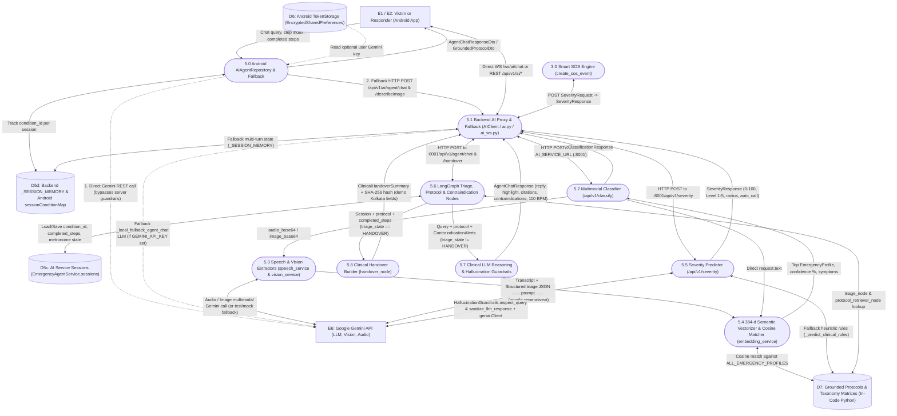

# DFD Level 2 — AI Triage, Classification & Crisis Agent (`Process 5.0`)

> **Related Documentation:** [ARCHITECTURE.md](../../ARCHITECTURE.md) | [AI_SYSTEM.md](../../AI_SYSTEM.md) | [API_REFERENCE.md §7](../../API_REFERENCE.md#7-ai-endpoints-backend-proxy-apiv1ai--ai-service-8001apiv1) | [KNOWN_ISSUES.md](../../KNOWN_ISSUES.md) | [DFD Level 1](dfd-level-1-system.md)

This Level 2 diagram details **Process `5.0 AI Triage & Crisis Agent`** across **all three actual execution layers** found in the repository:
1. **Android Client (`AiAgentRepository.kt`)** — which calls Gemini REST directly first whenever a user-configured key is saved in `TokenStorage`, and otherwise (or on failure) proxies to the backend.
2. **Backend AI Proxy & Fallback (`ai_client.py`)** — which forwards REST/WS requests to `ai_service` (`:8001`) and falls back to in-process triage/rules (and `gemini-3.5-flash-lite` in `_local_fallback_agent_chat` when `GEMINI_API_KEY` is set).
3. **AI Microservice (`ai_service/`, `:8001`)** — which runs the multimodal classifier, severity predictor, and compiled LangGraph agent.

---

## 1. AI Processing Pipeline Data Flow Diagram

---

## 2. Beginner-Friendly Walkthrough

How AI responses travel in NearHelp depends on which feature is running and which services are reachable:

1. **Multimodal SOS Classification (`5.2` -> `5.3` -> `5.4`):** When a victim provides text, voice audio, or a scene photo to `/classify`, `speech_service` turns voice into text, `vision_service` describes hazards and injuries in the photo, and `embedding_service` converts the combined text into a 384-number fingerprint (boosted for English, Bengali, and Hindi emergency words) to find the closest emergency profile via cosine similarity.
2. **Severity Scoring (`5.5`):** When `/severity` is called (including automatically during SOS creation), `SeverityPredictor` tries Gemini first for structured JSON scoring (`0–100`, `Level 1–5`, recommended search radius, `auto_call_emergency_services`), and falls back cleanly to deterministic clinical rules if Gemini is offline or unconfigured.
3. **First-Aid Chat Agent (`5.6` -> `5.7` / `5.8`):** Inside `ai_service`, every chat turn runs through a **LangGraph `StateGraph`**:
   - **`triage_node`** identifies the condition (e.g., `cardiac_arrest`, `severe_bleeding`) or switches to `HANDOVER` if asked for paramedics.
   - **`protocol_retriever_node`** pulls official step-by-step instructions, citations, and CPR metronome cadence (`110 BPM`).
   - **`safety_guardrail_node`** checks for dangerous actions (e.g., giving water to an unconscious person, putting a spoon in a seizure victim's mouth, removing an impaled knife).
   - **`reasoning_and_response_node`** runs `HallucinationGuardrails.inspect_query()`, checks hardcoded high-priority clinical answers, optionally calls Gemini with the protocol prompt, and runs `sanitize_llm_response()` afterward to make sure the LLM never gave unsafe medical advice.
   - **`handover_node`** builds a SHA-256-signed paramedic handover report (note: currently uses hardcoded Kolkata Sector V demo patient/hospital fields).
4. **Two Real-World Shortcuts to Know (`5.0` & `5.1`):**
   - If `ai_service` (`:8001`) is down, `backend/app/services/ai_client.py` (`5.1`) catches the failure and serves its own local fallback rules (or calls Gemini directly in `_local_fallback_agent_chat`).
   - On Android (`5.0`), if a user-configured Gemini key is stored in `TokenStorage`, `AiAgentRepository.chatWithAgent()` calls the Gemini REST API **directly from the phone first** before trying the backend proxy. When present, that path bypasses the server-side LangGraph guardrails completely.

---

## 3. Process Details & Source Mapping

| Sub-Process | Validations, Transformations & Caveats | Actual Source Code & Functions |
| :--- | :--- | :--- |
| **`5.0` Android AI Repository** | Reads optional `TokenStorage.getGeminiApiKey()` (`AiAgentRepository.kt:101`); calls `callGeminiDirectly()` if present -> falls back to Retrofit `apiService.chatWithAgent()` -> falls back to Kotlin keyword templates | [AiAgentRepository.kt](../../android/app/src/main/java/com/example/nearhelp/data/repository/AiAgentRepository.kt#L95-L150), [AiAgentApiService.kt](../../android/app/src/main/java/com/example/nearhelp/data/api/AiAgentApiService.kt) |
| **`5.1` Backend AI Proxy & Fallback** | Proxies `/classify`, `/severity`, `/taxonomy`, `/agent/*`, and `/ws/ai/chat` to `AI_SERVICE_URL`; uses `_SESSION_MEMORY` and `_local_fallback_*`; simulates 6-word WebSocket token chunking (`ai_ws.py`) | [ai.py](../../backend/app/api/ai.py), [ai_ws.py](../../backend/app/api/ai_ws.py), [ai_client.py](../../backend/app/services/ai_client.py#L122-L310) |
| **`5.2` Multimodal Classifier** | Combines `text`, `audio_base64`, `image_base64`, merges detected injuries/symptoms, computes processing latency | [classify.py](../../ai_service/app/api/classify.py#L30-L47), [emergency_classifier.py](../../ai_service/app/classifiers/emergency_classifier.py#L21-L91) |
| **`5.3` Speech & Vision Extractors** | `SpeechService.transcribe_audio` (`google.generativeai`) & `VisionService.analyze_scene` (`google.genai` JSON parsing); both include mock/UTF-8 test fallbacks when unconfigured | [speech_service.py](../../ai_service/app/classifiers/speech_service.py#L25-L98), [vision_service.py](../../ai_service/app/classifiers/vision_service.py#L17-L143) |
| **`5.4` 384-d Semantic Matcher** | `ClinicalSemanticVectorizer.embed_text` hashes unigrams + bigrams weighted by `CLINICAL_LEXICON` (EN/BN/HI); `match_emergency` ranks `ALL_EMERGENCY_PROFILES` by cosine similarity | [embedding_service.py](../../ai_service/app/classifiers/embedding_service.py#L14-L100) |
| **`5.5` Severity Predictor** | `SeverityPredictor.predict` tries `_predict_gemini_llm` JSON scoring; falls back to `_predict_clinical_rules` heuristics | [severity.py](../../ai_service/app/api/severity.py), [severity_predictor.py](../../ai_service/app/classifiers/severity_predictor.py#L20-L140) |
| **`5.6` LangGraph State & Guardrail Nodes** | `triage_node` -> `protocol_retriever_node` -> `safety_guardrail_node` -> `route_after_guardrails` conditional edge | [gemini_agent.py](../../ai_service/app/agent/gemini_agent.py#L244-L463), [agent.py](../../ai_service/app/api/agent.py), [agent_ws.py](../../ai_service/app/api/agent_ws.py) |
| **`5.7` LLM & Hallucination Guardrails** | `HallucinationGuardrails.inspect_query` -> deterministic clinical QA rules -> `genai.Client` (retry `gemini-1.5-flash`) -> `sanitize_llm_response` -> protocol step fallback | [gemini_agent.py](../../ai_service/app/agent/gemini_agent.py#L61-L234), [guardrails.py](../../ai_service/app/agent/guardrails.py#L33-L243) |
| **`5.8` Handover Generator** | Formats `ClinicalHandoverSummary` with SHA-256 signature; *caveat:* victim profile, address, compressions, and destination hospital are currently hardcoded demo values | [gemini_agent.py](../../ai_service/app/agent/gemini_agent.py#L353-L419) |
