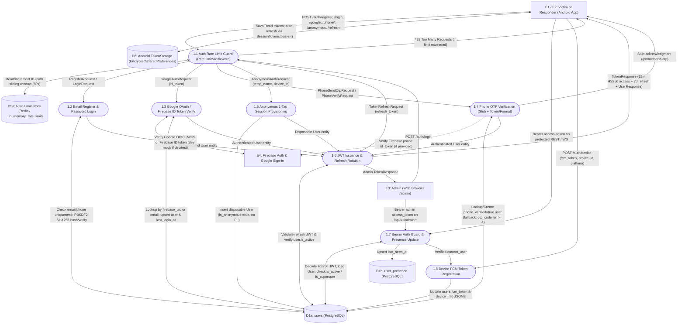

# DFD Level 2 — Authentication & Identity (`Process 1.0`)

> **Related Documentation:** [ARCHITECTURE.md](../../ARCHITECTURE.md) | [DATABASE.md](../../DATABASE.md#21-users-backendappmodelsuserpy) | [API_REFERENCE.md](../../API_REFERENCE.md#2-authentication--identity-apiv1auth) | [SECURITY.md](../../SECURITY.md) | [DFD Level 1](dfd-level-1-system.md)

This Level 2 diagram decomposes **Process `1.0 Auth & Identity Management`** into its internal validation, cryptography, third-party verification, token issuance, and per-request authentication/presence processes.

---

## 1. Authentication & Identity Data Flow Diagram

---

## 2. Beginner-Friendly Walkthrough

Think of authentication in NearHelp as **four entry doors** that all end up issuing the same two security passes: a **15-minute access token** and a **7-day refresh token**.

1. **Speed Bump (`1.1`):** Before any login or registration request touches the database, `RateLimitMiddleware` counts requests per client IP and endpoint path over a 60-second window so nobody can brute-force passwords.
2. **Door 1 — Email & Password (`1.2`):** Checks if the email or phone already exists, hashes or verifies passwords using PBKDF2-SHA256 (`passlib`), and updates `last_login_at`.
3. **Door 2 — Google Sign-In (`1.3`):** On Android, Credential Manager + Firebase Auth produces a Firebase ID token. The backend verifies it against Google's OIDC certificates or Firebase Admin SDK — **except** when `ENVIRONMENT` is `development`, `test`, or `testing`, where mock prefixes (`mock_`, `google_`, etc.) and unverified JWT fallbacks are accepted.
4. **Door 3 — Phone OTP (`1.4`):** `/phone/send-otp` is currently a placeholder stub that returns a success message without sending an SMS. `/phone/verify` verifies a real Firebase phone `id_token` if supplied, or accepts any `otp_code` with `len >= 4`.
5. **Door 4 — 1-Tap Anonymous Emergency (`1.5`):** Creates a disposable `User` row (`is_anonymous=True`) with no email or phone so someone in danger can broadcast an SOS immediately without signing up.
6. **Issuing & Checking Passes (`1.6`, `1.7`):** After any door succeeds, `_build_token_response()` signs HS256 JWTs (`access` and `refresh`). Whenever the Android app calls a protected API later (`SessionTokens.bearer()`), `get_current_user` checks the access token and updates `user_presence.last_seen_at` (`record_activity`) so the Admin dashboard knows who is online.

---

## 3. Process Details & Source Mapping

| Sub-Process | Validation & Transformation | Incoming -> Outgoing Data | Actual Source Code |
| :--- | :--- | :--- | :--- |
| **`1.1` Auth Rate Limit Guard** | Sliding window per `(IP, path)` over `60s`; falls back to `_in_memory_rate_limit` if Redis is unavailable | HTTP request -> Pass-through or `429 JSONResponse` | [middleware.py](../../backend/app/core/middleware.py) (`RateLimitMiddleware`) |
| **`1.2` Email Register & Login** | Normalizes `email.strip().lower()`, checks uniqueness (`409` on conflict), hashes/verifies password with PBKDF2-SHA256, checks `user.is_active` | `RegisterRequest` / `LoginRequest` -> `User` | [auth.py](../../backend/app/api/auth.py#L26-L54), [auth_service.py](../../backend/app/services/auth_service.py#L83-L160), [security.py](../../backend/app/core/security.py) |
| **`1.3` Google / Firebase OAuth** | Calls `verify_firebase_id_token(req.id_token)` (Google OIDC JWKS, Firebase Admin SDK, or dev/test fallback); matches or inserts `User` by `firebase_uid` or `email` | `GoogleAuthRequest` -> `User` | [auth_service.py](../../backend/app/services/auth_service.py#L162-L222), [firebase_service.py](../../backend/app/services/firebase_service.py#L69-L168), [GoogleAuthentication.kt](../../android/app/src/main/java/com/example/nearhelp/ui/auth/GoogleAuthentication.kt) |
| **`1.4` Phone OTP Auth** | `/phone/send-otp` is a static stub; `/phone/verify` verifies `id_token` via Firebase or validates `len(otp_code) >= 4` format | `PhoneSendOtpRequest` / `PhoneVerifyRequest` -> `MessageResponse` / `User` | [auth.py](../../backend/app/api/auth.py#L71-L100), [auth_service.py](../../backend/app/services/auth_service.py#L224-L280) |
| **`1.5` Anonymous Session** | Generates disposable UUIDv4 `User` with `auth_provider="anonymous"`, `is_anonymous=True`, and optional `device_info` | `AnonymousAuthRequest` -> `User` | [auth.py](../../backend/app/api/auth.py#L102-L115), [auth_service.py](../../backend/app/services/auth_service.py#L283-L307) |
| **`1.6` JWT Issuance & Refresh** | Builds HS256 `access` (15m, claims `sub`, `is_anonymous`, `email`, `role`) & `refresh` (7d) tokens; validates `"refresh"` token type on `/refresh` | `User` / `TokenRefreshRequest` -> `TokenResponse` | [auth_service.py](../../backend/app/services/auth_service.py#L60-L81), [auth_service.py#L310-L352](../../backend/app/services/auth_service.py#L310-L352), [SessionTokens.kt](../../android/app/src/main/java/com/example/nearhelp/data/api/SessionTokens.kt) |
| **`1.7` Bearer Auth & Presence** | `get_current_user` decodes access JWT, queries `users`, rejects inactive (`403`), calls `record_activity(db, user.id)`; `get_current_admin_user` checks `is_superuser` | HTTP `Authorization: Bearer` -> `User` + `user_presence` write | [dependencies.py](../../backend/app/core/dependencies.py#L19-L127), [presence_service.py](../../backend/app/services/presence_service.py) |
| **`1.8` FCM Token Registration** | Saves `req.fcm_token` and merges `device_id`, `platform`, `updated_at` into `users.device_info` | `DeviceRegisterRequest` -> `users` update | [auth.py](../../backend/app/api/auth.py#L131-L145), [auth_service.py](../../backend/app/services/auth_service.py#L355-L372) |

---

## 4. Data Stores Used

- **`D1a` (`users`):** Stores credentials (`hashed_password`), OAuth linkage (`firebase_uid`, `auth_provider`), `is_anonymous`, `is_active`, `is_superuser`, and `fcm_token`. ([DATABASE.md §2.1](../../DATABASE.md#21-users-backendappmodelsuserpy))
- **`D1b` (`user_presence`):** Stores one `last_seen_at` timestamp row per active user, updated on authenticated API calls for admin online-status counts. ([DATABASE.md §2.2](../../DATABASE.md#22-user_presence-backendappmodelsuser_presencepy))
- **`D5a` (Rate-Limit Store):** Sliding-window request timestamps stored in Redis when reachable or `_in_memory_rate_limit` dictionary otherwise.
- **`D6` (Android `TokenStorage`):** Uses `EncryptedSharedPreferences` (`nearhelp_secure_prefs`) to hold access/refresh JWTs, serialized user JSON, and pending SOS IDs. ([TokenStorage.kt](../../android/app/src/main/java/com/example/nearhelp/data/local/TokenStorage.kt))
