# DFD Level 2 — Core SOS Dispatch, Escalation & Live Tracking (`Processes 3.0 & 4.0`)

> **Related Documentation:** [ARCHITECTURE.md](../../ARCHITECTURE.md) | [DATABASE.md §2.3–2.5](../../DATABASE.md#23-sos_events-backendappmodelssos_eventpy) | [API_REFERENCE.md §4–5](../../API_REFERENCE.md#4-smart-sos-engine-apiv1sos) | [SYSTEM_DESIGN.md](../../SYSTEM_DESIGN.md) | [DFD Level 1](dfd-level-1-system.md)

This Level 2 diagram decomposes the end-to-end **SOS Emergency Lifecycle**: how an SOS trigger is deduplicated, scored, matched to nearby responders, escalated across 3 layers, tracked over WebSockets, and finally resolved with responder reputation updates.

---

## 1. Core Emergency Workflow Data Flow Diagram

```mermaid
flowchart TB
    %% External Entities
    E1["E1: Victim / Bystander (Android App)"]
    E2["E2: Community Responder (Android App)"]
    E5["E5: Firebase Cloud Messaging (FCM)"]
    E8["E8: Native Phone Dialer (108 / 112 / 101 / 100)"]

    %% External Process Link
    P5(["5.0 AI Triage Service (ai_client.predict_severity)"])
    P6(["6.0 Facilities Lookup (FacilityService)"])

    %% Data Stores
    D1[("D1: users (PostGIS location, skills, trust_score, fcm_token)")]
    D2a[("D2a: sos_events (PostgreSQL + PostGIS)")]
    D2b[("D2b: responses (PostgreSQL)")]
    D2c[("D2c: timeline_events (PostgreSQL)")]
    D5b[("D5b: Telemetry Cache, Idempotency, WS Rooms & Redis Pub")]

    %% Sub-processes
    P3_1(["3.1 Idempotency & Fingerprint Guard"])
    P3_2(["3.2 Pre-Persistence AI Severity Scoring"])
    P3_3(["3.3 Persist SOS Event & Audit Logs"])
    P3_4(["3.4 Spatial Search & Weighted Ranking"])
    P3_5(["3.5 FCM Dispatch & Arrival Alerts"])
    P3_6(["3.6 3-Layer Escalation Evaluator"])
    P3_7(["3.7 Responder Acceptance & ETA Setup"])
    P4_1(["4.1 Tracking WS Auth & Snapshot Builder"])
    P4_2(["4.2 Live GPS Telemetry & Arrival Trigger"])
    P4_3(["4.3 Status Sync & Incident Chat Relay"])
    P3_8(["3.8 Lock, Resolve / Cancel & Trust Reward"])

    %% Creation path
    E1 -->|"POST /sos/create + Idempotency-Key"| P3_1
    P3_1 <-->|"Check/Store HTTP cache (Redis) & UUIDv5 fingerprint"| D5b
    P3_1 <-->|"Replay existing SOSEvent on retry (409 on conflict)"| D2a
    P3_1 -->|"Validated SOSCreateRequest"| P3_2

    P3_2 <-->|"SeverityRequest / SeverityResponse"| P5
    P3_2 -->|"Severity score, priority, radius, skills, auto_call flag"| P3_3

    P3_3 -->|"Insert SOSEvent (status=SOS_TRIGGERED)"| D2a
    P3_3 -->|"Insert TimelineEvent (sos_created, ai_classified)"| D2c
    P3_3 -->|"Update broadcaster GPS point (update_user_location)"| D1
    P3_3 -->|"Saved SOSEvent"| P3_4

    %% Spatial + Ranking + Notify
    P3_4 <-->|"ST_DWithin / Haversine + 900s availability check"| D1
    P3_4 -->|"Ranked top-N responders (0.40*D + 0.35*S + 0.25*R)"| P3_5
    P3_4 -->|"SOSCreateResponse (top_ranked_responders, escalation)"| E1
    P3_5 -->|"messaging.send high-priority SOS data push"| E5
    E5 -->|"Emergency dispatch alert"| E2

    %% Escalation
    E1 -->|"POST /sos/{id}/escalate (elapsed_seconds, force_layer)"| P3_6
    P3_6 <-->|"Read/Update radius (2x/3x/max), layer 1->2->3, auto_call_108"| D2a
    P3_6 -->|"Log radius_expanded / escalation_layer_updated"| D2c
    P3_6 -->|"Trigger expanded-radius candidate search"| P3_4
    P3_6 -->|"SOSEscalationStatus (auto_call_108_triggered, number)"| E1
    E1 -.->|"Opens Android ACTION_DIAL locally"| E8

    %% Accept & Respond
    E2 -->|"POST /sos/{id}/respond (ACCEPTED / EN_ROUTE / ARRIVED)"| P3_7
    P3_7 <-->|"Read SOSEvent; transition to RESPONDER_ACCEPTED"| D2a
    P3_7 <-->|"Upsert SOSResponse (distance, ETA, ranking_score)"| D2b
    P3_7 -->|"Insert response_accepted / responder_arrived"| D2c
    P3_7 <-->|"Update responder GPS; fetch victim fcm_token"| D1
    P3_7 -->|"Send responder arrival push"| P3_5
    E5 -->|"Responder accepted notification"| E1

    %% Live Tracking WS
    E1 <-->|"WS /ws/tracking/{id} or GET /tracking"| P4_1
    E2 <-->|"WS /ws/tracking/{id} connect"| P4_1
    P4_1 <-->|"Read incident & active responder rows"| D2a
    P4_1 <-->|"Read SOSResponse engagements"| D2b
    P4_1 <-->|"Read cached or device_info GPS + skills"| D1
    P4_1 <-->|"Query nearest AED & Hospital"| P6
    P4_1 <-->|"Register socket in ws_manager._rooms & emit snapshot"| D5b

    E2 -->|"WS location_update or POST /tracking/location"| P4_2
    P4_2 <-->|"Read/Write _live_telemetry_cache & Redis publish"| D5b
    P4_2 <-->|"Update users.device_info coords"| D1
    P4_2 <-->|"Auto-set ARRIVED if <= arrival threshold"| D2b
    P4_2 -->|"Write RESPONDER_ARRIVED timeline milestone"| D2c
    P4_2 -->|"Broadcast ResponderTrackingUpdate & arrival milestone"| E1

    E1 <-->|"WS chat_message / action_log"| P4_3
    E2 <-->|"WS status_update / chat_message"| P4_3
    P4_3 <-->|"Update SOSResponse status"| D2b
    P4_3 -->|"Persist chat_message / RESPONDER_* timeline"| D2c
    P4_3 -->|"Broadcast new_message / fresh snapshot via WS rooms"| D5b

    %% Resolution / Cancellation
    E1 -->|"PUT /sos/{id}/resolve or /cancel"| P3_8
    P3_8 <-->|"SELECT ... FOR UPDATE; verify owner/admin; set RESOLVED/CANCELLED"| D2a
    P3_8 <-->|"Save feedback_score & notes"| D2b
    P3_8 -->|"Add +3.0/+2.0 trust_score reward to responders"| D1
    P3_8 -->|"Insert sos_resolved / sos_cancelled"| D2c
    P3_8 -->|"SOSResolveResponse (reputation_updates)"| E1
```

---

## 2. Beginner-Friendly Walkthrough

This diagram follows a single emergency from the moment a victim presses SOS until the rescue finishes:

1. **Prevent Duplicate Taps (`3.1`):** Weak mobile networks often retry an HTTP call. Both `IdempotencyMiddleware` (using Redis) and `SOSService` (turning `user_id + Idempotency-Key` into a deterministic UUIDv5 plus request hash) guarantee that pressing SOS twice on a flaky connection replays the same incident instead of creating two emergencies.
2. **AI Triage Before Saving (`3.2` -> `3.3`):** Before writing the SOS row to PostgreSQL, `SOSService` asks `ai_client` for a severity score (`1–5`), initial search radius, and required skills, then saves the `SOSEvent` and initial `TimelineEvent` audit records.
3. **Find & Rank Nearby Helpers (`3.4` -> `3.5`):** `GeoService` queries PostgreSQL/PostGIS (`ST_DWithin` within the radius) and keeps users who marked `available=True` within the last 15 minutes (`900s`). `RankingService` scores each candidate (`40%` distance, `35%` skill match, `25%` trust score) and sends FCM pushes to the top N.
4. **Auto-Expand if Nobody Accepts (`3.6`):** `escalate_sos` widens the radius at 30s (`2x`) and 45s (`3x`), and at 60s switches to **Layer 2** (`auto_call_108_triggered = True`, max `5000m`), prompting Android to open the native `108` dialer (`E8`).
5. **Accept & Track Live (`3.7` -> `4.1`–`4.3`):** When a responder accepts (`/respond`), victim & responder join the WebSocket room `/ws/tracking/{incident_id}`. Every GPS packet updates `_live_telemetry_cache` and `users.device_info`, recalculates ETA (`eta_service`), automatically marks `"ARRIVED"` when the responder enters the arrival threshold, and relays incident chat messages. Note: Redis Pub/Sub publishes updates, while actual delivery uses the in-memory `ws_manager._rooms` dictionary.
6. **Resolve & Reward (`3.8`):** Using a `SELECT ... FOR UPDATE` database lock, only the broadcaster (or an admin) can resolve or cancel the SOS. Resolving rewards active responders with up to `+5.0` `trust_score` points (`+3.0` base + `+2.0` if feedback `>= 4.0`).

---

## 3. Process Details & Source Mapping

| Sub-Process | Validations & Transformations | Actual Source Code & Functions |
| :--- | :--- | :--- |
| **`3.1` Idempotency Guard** | Checks `Idempotency-Key` HTTP middleware cache (`idempotency:<sha256>`) and derives UUIDv5 + SHA-256 `request_fingerprint`; returns `409` on payload mismatch | [middleware.py](../../backend/app/core/middleware.py#L50-L140), [sos_service.py](../../backend/app/services/sos_service.py#L99-L106) |
| **`3.2` AI Severity Scoring** | Calls `ai_client.predict_severity(SeverityRequest(...))`. *Known schema mismatch:* `SOSService` passes `crisis_type`/`symptoms`/`photo_url` which `SeverityRequest` ignores (`emergency_type`/`detected_symptoms`) | [sos_service.py](../../backend/app/services/sos_service.py#L107-L115), [ai.py (schema)](../../backend/app/schemas/ai.py) |
| **`3.3` Persist SOS & Timeline** | Writes `SOSEvent` (`status="SOS_TRIGGERED"`), `TimelineEvent` (`"sos_created"`, `"ai_classified"`), handles `IntegrityError` retry race, updates broadcaster location | [sos_service.py](../../backend/app/services/sos_service.py#L126-L206) |
| **`3.4` Spatial Search & Ranking** | Runs PostGIS `ST_DWithin` / `ST_Distance` (or Haversine fallback) + `is_available` (`900s` TTL); scores `0.40*D + 0.35*S + 0.25*R`; caps top `{5:15, 4:8, 3:5, 2:3, 1:2}` | [geo_service.py](../../backend/app/services/geo_service.py#L43-L192), [ranking_service.py](../../backend/app/services/ranking_service.py#L108-L184) |
| **`3.5` Notification Fan-Out** | Sends FCM Android high-priority data messages via `firebase_admin.messaging.send` and records audit dict in `DISPATCHED_NOTIFICATIONS` | [notification_service.py](../../backend/app/services/notification_service.py#L87-L133) |
| **`3.6` 3-Layer Escalation** | Scales radius (`2x` at 30s, `3x` at 45s, `max_radius_meters` at 60s), enables `auto_call_108_triggered`, notifies newly reached responders | [sos.py](../../backend/app/api/sos.py#L109-L122), [sos_service.py](../../backend/app/services/sos_service.py#L512-L622) |
| **`3.7` Responder Accept** | Blocks self-response and ended SOS; calculates distance/ETA; creates/updates `SOSResponse`; sets `"RESPONDER_ACCEPTED"`; notifies victim | [sos.py](../../backend/app/api/sos.py#L90-L106), [sos_service.py](../../backend/app/services/sos_service.py#L385-L509) |
| **`4.1` WS Auth & Snapshot** | Validates `SOSEvent` existence (`4004`) and optional JWT (`1008`); assigns role (`victim`/`responder`/`admin`/`dispatcher`/`guest`); emits `ConnectionAck` + `TrackingSnapshot` (with nearest AED/Hospital) | [tracking_ws.py](../../backend/app/api/tracking_ws.py#L73-L175), [websocket_manager.py](../../backend/app/core/websocket_manager.py#L47-L90), [tracking_service.py](../../backend/app/services/tracking_service.py#L76-L264) |
| **`4.2` Live GPS & Arrival** | Validates `LocationUpdateMessage`; verifies active engagement; caches coords in `_live_telemetry_cache` + `User.device_info`; computes ETA; triggers `"ARRIVED"` & `"RESPONDER_ARRIVED"` | [tracking_ws.py](../../backend/app/api/tracking_ws.py#L205-L245), [tracking_service.py](../../backend/app/services/tracking_service.py#L267-L408) |
| **`4.3` Status & Chat Relay** | Validates `status_update` transitions, rebuilds & broadcasts snapshot; persists `chat_message` to `timeline_events` and broadcasts `"new_message"` | [tracking_ws.py](../../backend/app/api/tracking_ws.py#L246-L344), [tracking_service.py](../../backend/app/services/tracking_service.py#L411-L469) |
| **`3.8` Resolve / Cancel & Trust** | Acquires `with_for_update()` row lock; enforces owner or superuser; updates `RESOLVED`/`CANCELLED`; increments responders' `trust_score` (`+3.0`/`+2.0`, max `100.0`) | [sos_service.py](../../backend/app/services/sos_service.py#L625-L720) |
