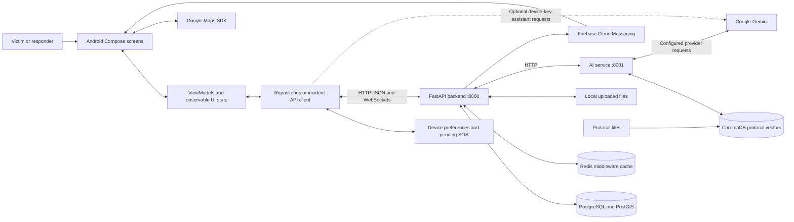
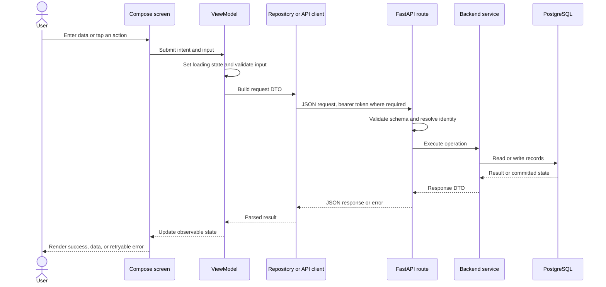
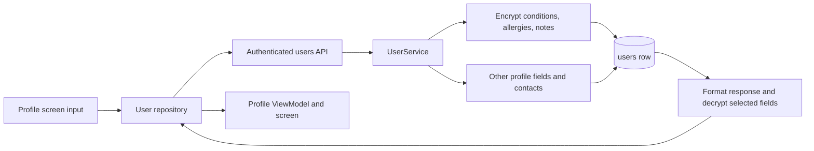
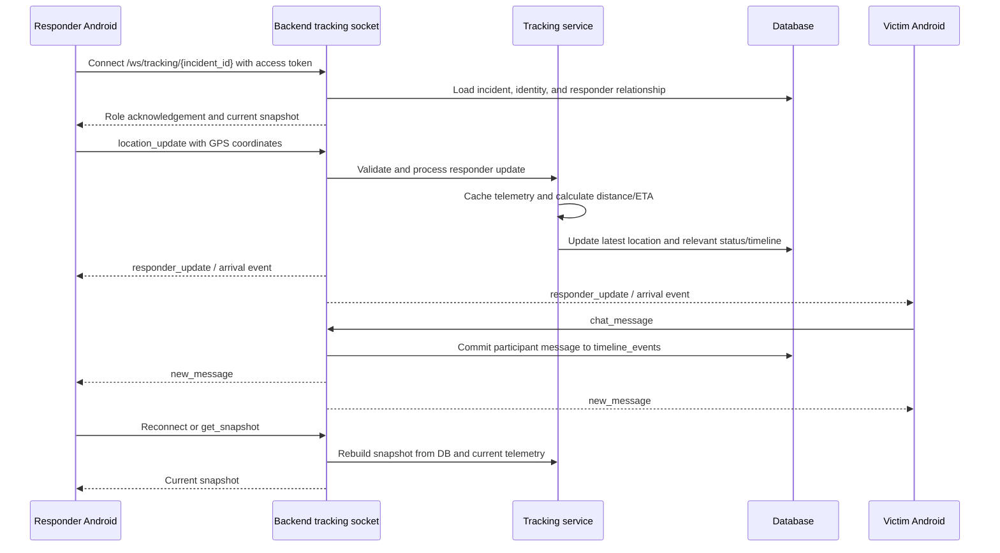
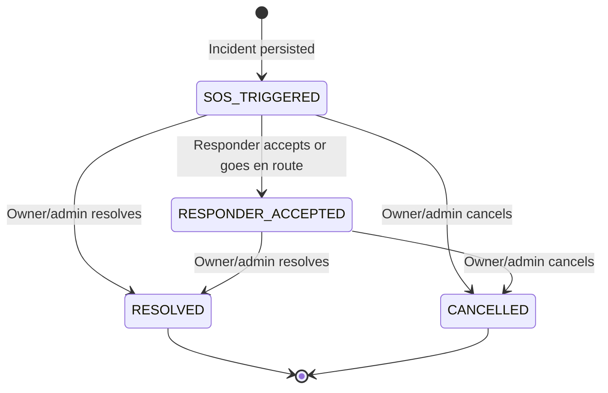
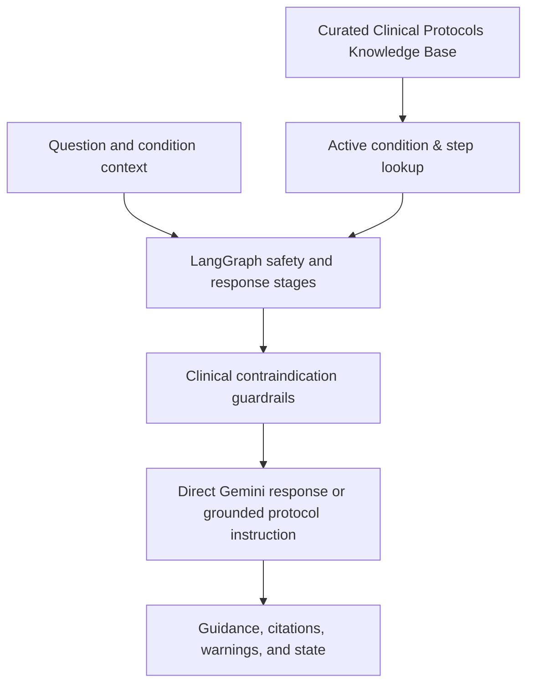

# NearHelp — Application and Data Flow

Last reviewed: **2 November 2026**

This document traces data from user input through Android, APIs, processing, storage, and back to the screen. It describes this checkout, including fallback branches and current access boundaries. For the reasoning behind these choices, see [decisions.md](decisions.md).

## 1. System overview



The backend is the authority for incident and responder state. Android renders returned DTOs and socket messages; a successful local animation is not evidence that an SOS was stored. The AI service does not directly own the user or incident tables.

**Transport:** The diagrams describe logical HTTP/WebSocket exchanges. Use HTTPS/WSS for a hosted backend; the documented LAN development setup uses HTTP/WS. Compose also exposes the AI port locally, so the intended internal-service boundary is not automatically enforced by deployment configuration.

## 2. The common Android request/response path



Most features use repositories. [IncidentViewModel](android/app/src/main/java/com/example/nearhelp/ui/incident/IncidentViewModel.kt) currently calls [SosApiService](android/app/src/main/java/com/example/nearhelp/data/api/SosApiService.kt) directly. Requests go to the single configured [Retrofit backend URL](android/app/src/main/java/com/example/nearhelp/data/api/RetrofitClient.kt).

## 3. Sign-up, sign-in, session refresh, and logout

### Email/password

1. The authentication screen passes email/password and, for registration, profile fields to `AuthViewModel` and `AuthRepository`.
2. The repository sends `POST /api/v1/auth/register` or `/login`.
3. Pydantic validates the request. `AuthService` checks account state, hashes a new password with bcrypt or verifies the existing hash, and writes/reads `users`.
4. The backend returns access token, refresh token, and user data. Password hashes remain server-side; plaintext passwords are request inputs, not stored account fields.
5. `TokenStorage.saveSession` saves tokens and selected profile values. Authentication state drives navigation to the main app.
6. Requests using `SessionTokens` obtain a usable access token, refreshing through `POST /api/v1/auth/refresh` when needed. Refresh handling is explicit; do not assume every Retrofit method has an automatic auth interceptor.
7. Logout clears local session preferences. This does not delete the server account, incidents, or medical records, and is not a demonstrated server-side JWT revocation flow.

### Google, phone, and guest branches

| Branch | Input → backend | Processing and destination | Current boundary |
| --- | --- | --- | --- |
| Google | Firebase ID token → `POST /auth/google` | Verify provider identity, find/create linked `users` row, issue backend JWTs | Requires Firebase configuration and a real client provider flow |
| Phone | Number → `POST /auth/phone/send-otp`; token/code → `/phone/verify` | Link/create phone account and issue backend JWTs | Send route is an acknowledgement; code-only verification checks length, not an issued OTP |
| Guest | Optional temporary name → `POST /auth/anonymous` | Create anonymous user UUID and temporary backend session | Guest access still creates stored identity/session data |

All abbreviated `/auth/...` paths above are under `/api/v1`. Device preferences normally use Android encrypted storage, but initialization failure falls back to ordinary app-private preferences.

**Sources:** [auth API](backend/app/api/auth.py), [auth service](backend/app/services/auth_service.py), [AuthRepository](android/app/src/main/java/com/example/nearhelp/data/repository/AuthRepository.kt), [SessionTokens](android/app/src/main/java/com/example/nearhelp/data/api/SessionTokens.kt), [TokenStorage](android/app/src/main/java/com/example/nearhelp/data/local/TokenStorage.kt).

## 4. Profile, medical ID, contacts, and verification data



- **Read/update profile:** `GET`, `PUT`, or `PATCH /api/v1/users/me`. The backend resolves the current user from the bearer token rather than trusting a user ID from the form.
- **Medical ID:** `GET`, `PUT`, or `PATCH /api/v1/users/me/medical`. Conditions, allergies, and notes are serialized and encrypted with AES-256-GCM before storage; authorized reads decrypt them. Blood group, pacemaker/organ-donor flags, and contacts are not covered by that encryption helper.
- **Emergency contacts:** `/api/v1/users/me/contacts` endpoints manipulate the user's JSON contact list, with a maximum of five contacts. Storing a contact does not itself send them an emergency notification.
- **Avatar/certificate uploads:** Multipart bytes are validated and written to local upload directories. A URL is returned and associated with the profile or skill claim. HTTP clients later read files from the `/uploads` static mount.
- **Skill claims:** Claim/certificate data creates a verification record; an administrator reviews it. Approved skill information and trust changes feed subsequent responder ranking. These APIs exist independently of whether every action has a finished mobile screen.

The profile is **not automatically copied wholesale into every AI request or FCM alert**. Data passed to those integrations follows their explicit request construction below. Legacy medical values may remain plaintext because the decrypt helper accepts old formats.

**Sources:** [user routes](backend/app/api/users.py), [user service](backend/app/services/user_service.py), [encryption](backend/app/core/crypto.py), [skill service](backend/app/services/skill_service.py), [admin routes](backend/app/api/admin.py).

## 5. Availability and device location before dispatch

1. A responder opens community incidents and enables **Available to help**.
2. Android requests location permission and obtains a device fix. The incident ViewModel ignores fixes at least two minutes old.
3. Android sends `PUT /api/v1/users/me/location` with latitude, longitude, and availability.
4. The backend records availability and location freshness in `users.device_info`, saves latest coordinates, and updates the PostGIS point where applicable.
5. Dispatch lookup requires an active account, usable coordinates, availability enabled, and a location heartbeat less than **900 seconds** old.
6. Responders without known coordinates are skipped rather than placed at a fabricated location.

Availability expiry changes eligibility; it does not erase the last stored coordinates. Current sharing is tied to foreground screens, not a continuous background location service.

**Sources:** [location helper](android/app/src/main/java/com/example/nearhelp/data/location/LocationHelper.kt), [incident ViewModel](android/app/src/main/java/com/example/nearhelp/ui/incident/IncidentViewModel.kt), [user location API](backend/app/api/users.py), [geo service](backend/app/services/geo_service.py).

## 6. SOS creation, persistence, dispatch, and retry

```mermaid
sequenceDiagram
    actor Victim
    participant App as Android incident flow
    participant Local as Device preferences
    participant API as Backend SOS API
    participant AI as AI service or backend fallback
    participant DB as PostgreSQL/PostGIS
    participant Push as FCM
    participant Responder as Responder phone
    Victim->>App: Hold SOS, select category, add notes/landmark
    App->>App: Require a fresh GPS fix
    App->>Local: Save request key and exact pending payload
    App->>API: POST /api/v1/sos/create + Idempotency-Key
    API->>DB: Look up stable incident UUID
    alt Matching incident already exists
        DB-->>API: Existing incident and fingerprint
        API-->>App: Recover existing incident
    else New incident
        API->>AI: Await severity prediction
        AI-->>API: Severity, priority, skills, radius, actions
        API->>DB: Commit incident and initial timeline
        API->>DB: Find nearby available responders
        DB-->>API: Candidate identities and distances
        API->>API: Rank and select candidates
        loop Selected responders
            API->>Push: High-priority dispatch request
            Push-->>API: Accepted or failed
            Push-->>Responder: Device alert if deliverable
        end
        API-->>App: Incident UUID, triage, dispatch result
    end
    App->>Local: Clear pending request; save active incident ID
    App->>App: Open incident and start tracking
```

### What enters the system

The current Android DTO sends **latitude, longitude, crisis type, description, and address**. The backend schema additionally accepts fields such as symptoms, voice transcript, photo URL, anonymity, and an initial radius override; their existence does not mean the Android SOS form captures voice or photos.

The bearer identity determines the broadcaster for an ordinary incident. An explicitly anonymous API incident stores no `broadcaster_id`. Android's current DTO does not send `is_anonymous`, so an anonymous login session can still create an incident linked to its guest UUID.

### How the backend transforms it

1. Compute a payload fingerprint and, when a request key is present, a stable UUID scoped to that user/key.
2. If that incident already exists, verify the fingerprint and return its data. A different payload with the same key returns HTTP 409.
3. Call severity prediction using crisis type/subtype, description or transcript, symptoms, and photo URL. The backend AI client has a default ten-second timeout and local fallback behavior.
4. Use the result for severity level/score, priority, required responder skills, initial radius, and immediate action. The current code **waits for this result** before incident persistence and dispatch.
5. Store `sos_events`, initial `timeline_events`, triage JSON, and request metadata. Update the non-anonymous user's latest location where applicable.
6. Query PostGIS using `ST_DWithin`/`ST_Distance`; filter for fresh availability. If spatial lookup fails, isolate the failed query and use Haversine filtering over known stored coordinates.
7. Rank candidates with proximity, skills, and trust; select a severity-dependent number and request FCM dispatch for each.
8. Return the incident response. `candidates_notified_count` counts successful provider acceptance results, not human acknowledgements.

### Interrupted requests

The phone retains the same payload and key until it receives success. A retry can recover the persisted incident even after a backend restart. Redis/memory middleware can also replay cached HTTP responses. If the server committed the incident but stopped during notifications, recovering the incident does **not** resume unfinished push sends; there is no durable dispatch queue here.

**Sources:** [Android request DTO](android/app/src/main/java/com/example/nearhelp/data/api/SosApiService.kt), [incident ViewModel](android/app/src/main/java/com/example/nearhelp/ui/incident/IncidentViewModel.kt), [SOS schema](backend/app/schemas/sos.py), [SOS service](backend/app/services/sos_service.py), [AI client](backend/app/services/ai_client.py).

## 7. Notification delivery and responder discovery

There are two paths to discovering an incident:

| Path | Data movement | Result |
| --- | --- | --- |
| Push | Firebase token → device registration API → `users.fcm_token`; incident dispatch → Firebase Admin/FCM → Android messaging service | Notification opens the incident identified by the payload |
| Foreground feed | Android → `GET /api/v1/sos/active` every ten seconds → active `sos_events` → incident list UI | Responder opens an incident and chooses to respond |

The current feed returns active incidents with a limit and optional calculated distances; it is not a guaranteed radius-restricted or participant-only feed. The Android incident browser currently calls it without coordinate filters.

To accept, Android sends `POST /api/v1/sos/{id}/respond` with status and available coordinates. The backend rejects self-response and ended incidents, stores/updates `responses`, records the timeline, and may transition the incident to `RESPONDER_ACCEPTED`. It can notify the broadcaster, then the responder connects/reconnects to tracking with the new role.

Initial response ETA is an estimate; if response coordinates are absent, the service currently uses an 800 m fallback for its initial calculation. Live tracking later uses actual known positions.

**Sources:** [messaging service](android/app/src/main/java/com/example/nearhelp/notifications/NearHelpMessagingService.kt), [notifications](backend/app/services/notification_service.py), [SOS service](backend/app/services/sos_service.py), [device configuration](docs/DEVICE_READINESS.md).

## 8. Live tracking, snapshots, chat, and reconnection



- **Connection:** The socket resolves identity from a token query parameter and assigns victim, responder, admin, dispatcher, or guest role. Invalid supplied tokens are rejected. A read connection without a token is currently possible.
- **GPS updates:** The service checks incident and response state, records latest telemetry, derives ETA/bearing, and emits updates to the incident room. Arrival can create a timeline milestone. Positions with no known coordinates are omitted from snapshots.
- **Chat/actions:** Victim, responder, and admin roles may write chat/action logs. Chat is stored as `timeline_events` with text/language and actor ID before broadcast. An unaccepted dispatcher or unauthenticated guest cannot write participant chat.
- **Recovery:** On connection, the server sends a snapshot. Android also polls incident details and requests snapshots every five seconds. Socket events trigger targeted UI updates or a detail refresh.
- **Failure display:** A disconnected chat send returns a visible failure; it is not silently queued as delivered. Intentional navigation away closes the socket; ViewModel cleanup releases it.
- **Scaling:** Rooms and high-frequency telemetry live in one backend process. Redis publication has no implemented cross-worker subscriber, so this flow requires one worker/replica for the documented trial.

HTTP alternatives include `GET /api/v1/sos/{incident_id}/tracking` and `POST /api/v1/sos/{incident_id}/tracking/location`. The current incident screen uses the socket path for live updates.

**Sources:** [tracking socket API](backend/app/api/tracking_ws.py), [tracking service](backend/app/services/tracking_service.py), [socket manager](backend/app/core/websocket_manager.py), [Android socket client](android/app/src/main/java/com/example/nearhelp/data/api/ws/LiveTrackingWebSocketClient.kt).

## 9. Escalation, cancellation, and resolution



This shows the core implemented incident path, not every status string listed in models. Individual responders also have their own statuses, such as `ACCEPTED`, `EN_ROUTE`, and `ARRIVED`; they are distinct from the incident status.

**Escalation:** `POST /api/v1/sos/{id}/escalate` receives elapsed time or a forced layer. The service expands the current radius at 30/45-second gates, caps it at 5 km, can set layer 2 after 60 seconds, and supports forcing layer 3. It persists changes and timeline events, then looks up/ranks responders again if the radius grew. This depends on an API invocation; reading elapsed-time-based escalation flags does not schedule a real call or dispatch worker.

**Resolve:** `PUT /api/v1/sos/{id}/resolve` authenticates the actor, locks the incident row, verifies owner/admin authority, rejects an already ended incident, stores resolution/feedback, updates eligible responders' trust, writes the timeline, and commits. Repeated resolution cannot award the same incident's reward again.

**Cancel:** `PUT /api/v1/sos/{id}/cancel` checks owner/admin authority, stores `CANCELLED` and an end timestamp, and records a timeline event. Android refreshes details and clears its saved active ID after observing an ended state.

No automatic deletion of incident text, chat, contacts, or latest location occurs as part of these endings. An explicitly anonymous API incident with no broadcaster has no ordinary owner identity for these checks.

**Source:** [SOS routes](backend/app/api/sos.py), [lifecycle service](backend/app/services/sos_service.py).

## 10. AI assistant and protocol data flow

### Corpus ingestion and retrieval



AI-service startup warms classification reference embeddings for multimodal triage. Curated emergency guidelines in `EMERGENCY_KNOWLEDGE_BASE` provide structured steps, citations, and contraindications.

### A user question has three possible processing paths

1. **Optional direct provider path:** If a device Gemini key exists, `AiAgentRepository` attempts a Google Gemini request directly. Question/context data leaves the device without going through the backend or server agent graph.
2. **Backend path:** Otherwise, or after direct failure, the repository sends an agent chat request to the backend (`POST /api/v1/ai/agent/chat`). It includes session ID, text, role, current step, and completed steps. The backend proxies to the AI service's `/agent/chat` endpoint.
3. **Local app fallback:** If the backend fails or returns a response the repository classifies as generic for that query, the repository constructs a response from built-in condition/protocol logic.

On the AI service, the graph runs **triage → protocol lookup → safety guardrail → reasoning/response or handover**. Session state tracks the current condition and completed steps in process memory. The response returns guidance, citations, warnings, step state, and related UI fields; the ViewModel renders them in the crisis assistant.

The backend has its own fallback if the AI service fails, including local guidance/session handling and optional direct Gemini generation when server credentials exist. A successful backend response therefore does not establish that remote AI succeeded. AI chat sessions are separate from incident participant chat; they are not automatically persisted as the same timeline.

AI WebSocket routes also exist at `/ws/ai/chat` and `/api/v1/ws/ai/chat`; the Android repository's chat method above uses HTTP. Do not confuse an available socket API with the active UI transport.

**Sources:** [Android AI repository](android/app/src/main/java/com/example/nearhelp/data/repository/AiAgentRepository.kt), [backend AI API](backend/app/api/ai.py), [backend AI client](backend/app/services/ai_client.py), [agent graph](ai_service/app/agent/gemini_agent.py), [guardrails](ai_service/app/agent/guardrails.py), [knowledge catalog](ai_service/app/agent/knowledge.py).

## 11. Facilities, maps, routes, and external coordinates

- **Facilities:** Regional JSON → backend seeding → `facilities` table → nearby facility API/tracking snapshot → Android map markers and resource cards. Stored capacity/contact values are dataset or API data, not a demonstrated real-time hospital feed.
- **Map display:** Android coordinates/markers → Google Maps SDK → rendered map. The map integration requires an Android API key and platform configuration.
- **Route calculation:** Origin, destination, travel mode, hazards, and optional AED information → routing API → routing service → route alternatives and estimates → routing repository/ViewModel → navigation screen.
- **External route branch:** The routing service can attempt Google Routes with origin/destination when a server key is available; current backend settings do not declare the key it looks up. Otherwise local calculations build estimates and constructed polylines, including regional demo instructions.
- **Hazards:** Curated defaults and submitted hazards live in routing-service process memory. They are not an established live road-authority stream and do not survive every process restart.

**Sources:** [facility service](backend/app/services/facility_service.py), [routing API](backend/app/api/routing.py), [routing service](backend/app/services/routing_service.py), [Android map](android/app/src/main/java/com/example/nearhelp/ui/map/NearHelpGoogleMapView.kt).

## 12. Where each data category lives

| Data | Device | Backend/database or files | External destination / lifecycle |
| --- | --- | --- | --- |
| Password | Entered for auth request | bcrypt hash in `users` | Sent to configured backend; not a profile response field |
| Access/refresh tokens | Session preferences | Validated by backend | Sent on relevant requests; local logout clears preferences |
| Profile/contact values | UI state and selected cached values | `users` fields/JSON | No automatic contact alert merely from storage |
| Conditions/allergies/notes | Profile UI on retrieval | Selected fields encrypted at rest | Authorized profile responses contain decrypted values |
| Latest user coordinates | Location/UI state | `users.location` and `device_info` | Incident room viewers; Google integrations on relevant paths; no automatic end-of-incident purge |
| SOS details and triage | Pending payload, active ID, UI DTO | `sos_events`, triage/metadata JSON | Selected text/context to AI; dispatch metadata to FCM; retained after ending |
| Responses and feedback | Incident UI | `responses`, user trust changes | Used for state and future ranking |
| Participant chat/actions | Incident UI | `timeline_events` | Room broadcast plus later detail/timeline reads |
| High-frequency telemetry | Socket/UI state | Process cache plus latest stored coordinates | Process cache is not a durable full movement history |
| FCM device token | Device preferences | `users.fcm_token` | Firebase delivery service; stored token is associated with account |
| Avatar/certificate bytes | Upload input | Local `uploads` files; URLs/review metadata in DB | Static URLs are currently served without download authorization |
| AI assistant turns | UI/repository state | Process-local agent/fallback sessions | Gemini on configured branches; durable transcript storage not established |
| User Gemini key | Device preferences when configured | Not part of ordinary profile records | Used to authenticate direct Google API requests |
| Protocols/vectors | Built-in fallback guidance | Repository corpus and AI-owned Chroma store | Protocol/query text to provider embedding API when enabled |
| Middleware response cache | None | Redis or process memory, configured 24-hour default TTL | Can contain API response bodies; not the authoritative incident store |

## 13. Access boundaries and failure behavior to preserve

These are descriptions of the current implementation, rather than additional policy guarantees:

| Boundary or failure | Current behavior |
| --- | --- |
| Profile writes / medical reads | Authenticated current-user APIs |
| Incident resolve/cancel | Owner/admin checks; no owner for explicitly unlinked anonymous incidents |
| Incident details/timeline | Current HTTP routes do not require participant authentication |
| Active incident discovery | Optional authentication; broader than incident participants |
| Tracking read connection | Can admit guests/readers; token alone does not imply participant role |
| Chat/action writes | Limited to victim/responder/admin roles |
| AI endpoints / session IDs | Do not assume a session ID is an authenticated user authorization boundary |
| Redis unavailable | Process-memory middleware fallback; no shared multi-worker state |
| AI unavailable | Backend heuristic/guidance fallback; mobile also has built-in guidance |
| Backend unavailable | Request error and retained pending SOS; no automatic alternate backend |
| Firebase absent | Push is unsuccessful; foreground discovery remains usable if backend is reachable |
| Socket disconnected | Reconnect/snapshot/polling recovery; chat send reports failure |
| Backend restarts | Database incident/chat survives; process rooms/telemetry/agent memory do not |

The original architecture's privacy and reliability goals go beyond some of these current boundaries. In particular, broad read visibility, public static uploads, process-local coordination, and the absence of a deletion/retention worker should remain visible in implementation planning.

## 14. Checking and updating these flows

For a two-phone walkthrough and configuration, use [DEVICE_READINESS.md](docs/DEVICE_READINESS.md). [backend/scripts/device_smoke.py](backend/scripts/device_smoke.py) exercises real HTTP/WebSocket incident creation, responder GPS/chat, reconnection, and resolution against a test backend. It creates test records and does not establish physical notification delivery, clinical accuracy, or production readiness.

When an endpoint, DTO, store, provider, access check, retry rule, or lifecycle transition changes, update its flow here and the corresponding entry in [decisions.md](decisions.md). Diagrams should describe the executable path, with proposed behavior explicitly marked as planned.
