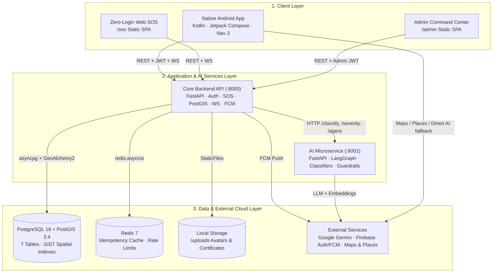
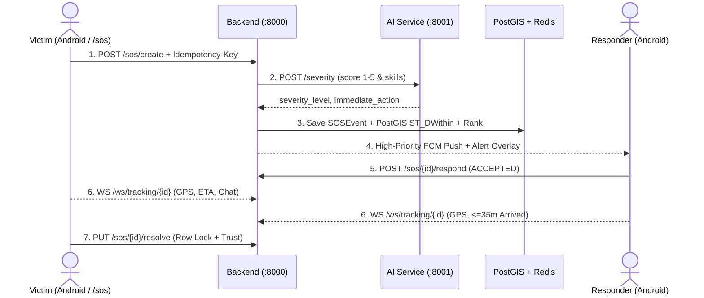
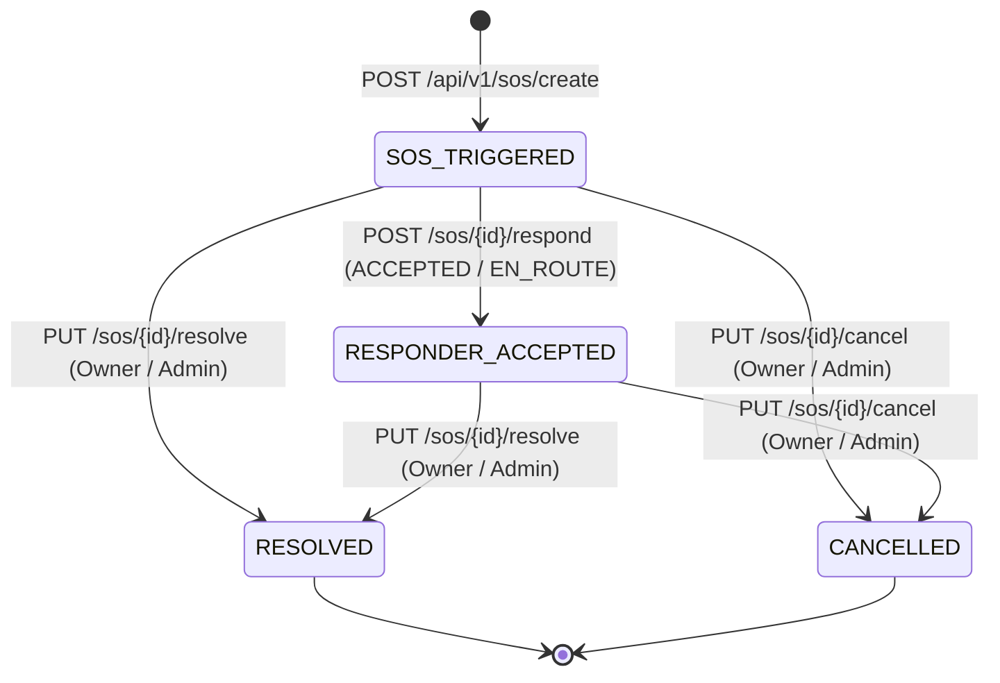
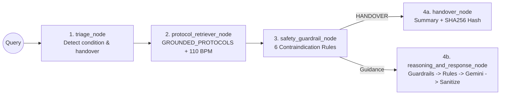
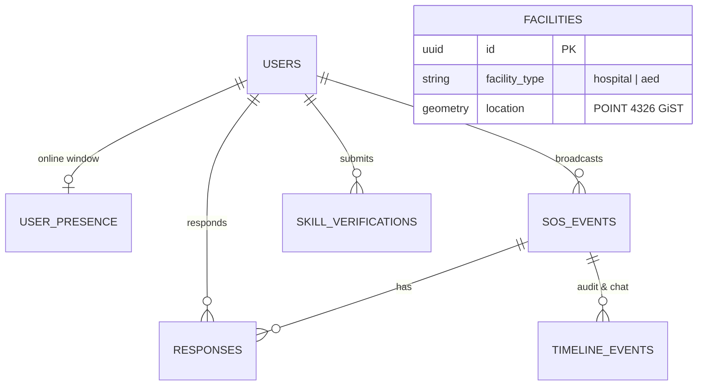

# NearHelp AI — Final Year Project Presentation Deck (`presentation.md`)

> **Deck Specifications:**
> - **Total Slides:** **15 Slides** (strictly within the 15-slide maximum; `> 12` slides for a 6-member team).
> - **First Slide:** Project Name, About the Project, Domain & 6-Member Team.
> - **Last Slide:** Dedicated **Thank You & Q&A** slide.
> - **Includes Dedicated Screenshot & Visual Slots** for the **Android App**, **Zero-Login Web SOS (`/sos`)**, **Admin Command Center (`/admin`)**, **Swagger APIs**, and **Architecture/Flow Diagrams**.
>
> **6-Member Presentation Split (2–3 slides per member):**
> - **Member 1 (Project Lead):** Slides 1–2 *(Title & About · Problem, Objectives & Overall Plan)*
> - **Member 2 (System Architect):** Slides 3–4 *(3-Tier Architecture Plan · End-to-End Flow, Tech Stack & Deployment)*
> - **Member 3 (Mobile & Web UI Lead):** Slides 5–7 *(Android Core SOS Screenshots · Android Care/Map/AI Screenshots · Web `/sos` & Admin `/admin` Screenshots)*
> - **Member 4 (Backend & Geospatial Lead):** Slides 8–9 *(Smart SOS & Idempotency · PostGIS Dispatch, Ranking, Live WS & Escalation)*
> - **Member 5 (AI/ML Lead):** Slides 10–11 *(Multimodal Triage & Severity · 5-Node LangGraph Agent, Guardrails & Fallbacks)*
> - **Member 6 (Database, Security & QA Lead):** Slides 12–14 *(Database & Kolkata Datasets · Security & Testing Results · Challenges & Future Scope)*
> - **All Members:** Slide 15 *(Thank You & Live Demo)*

---

## Slide 1: Title & Project Introduction
**Presenter:** Member 1 (Project Lead)  
**PPT Visuals:** Embed project logo (`android/design/nearhelp-logo-preview.png`) on top-left; clean Deep Teal (`#17635D`) accent banner; 6 member cards along the footer.

### NearHelp AI
**AI-Powered Community Emergency Response Network**  
*"Connecting People. Coordinating Rescue. Powered by AI."*

- **About the Project:**
  - A multi-tier emergency response system bridging the **critical survival gap before professional ambulances (`108` / `112`) arrive**.
  - Connects a **Victim (Broadcaster)** with nearby, skill-verified **Community Responders** via PostGIS spatial dispatch, live WebSocket GPS tracking, FCM push alerts, and a **guardrailed AI Crisis Assistant**.
- **Category:** Final Year BCA Project | **Pilot Region:** Kolkata, India (Salt Lake Sector V / EM Bypass)
- **Domain:** AI/ML · Mobile Computing · Geospatial Systems · Real-Time Coordination
- **Team Members (6):** `[Member 1]` · `[Member 2]` · `[Member 3]` · `[Member 4]` · `[Member 5]` · `[Member 6]`
- **Faculty Guide:** `[Guide Name]` | **Institution:** `[College / University Name]`

> **Speaker Notes:**  
> "Good morning/afternoon respected faculty and panel members. We present **NearHelp AI**—an AI-powered community emergency response network built as our final year BCA project. When a medical crisis happens, the first 3 to 5 minutes decide outcomes. NearHelp AI connects someone in distress with nearby, skill-verified community responders and clinically guardrailed first-aid guidance while professional `108` or `112` services are on the way."

---

## Slide 2: Problem Statement, Objectives & Overall Project Plan
**Presenter:** Member 1 (Project Lead)  
**PPT Visuals:** Left: "Golden Minutes Gap" comparison table. Right: 3-Phase Project Execution Roadmap graphic.

### Problem Statement & Overall Plan

- **Why Existing Systems Fall Short:**

| Option | Core Limitation |
| :--- | :--- |
| **Traditional `112` / `108` Calls** | Professional-only dispatch; unavoidable traffic/travel delay; no nearby bystander layer |
| **WhatsApp / Social Media** | Unstructured noise; no skill verification, live GPS tracking, or safe clinical instructions |
| **Generic SOS Apps** | Blind broadcast to everyone or contacts only; no triage, ranking, or escalation |

- **Core Objectives & Overall Plan (Phased Execution):**
  1. **Phase 1 — Core Rescue Pipeline (Implemented):** Zero-barrier auth/anonymous bypass, 2-second hold SOS, two-layer idempotency, PostGIS dispatch, live WebSocket tracking, native Android app.
  2. **Phase 2 — AI Safety, Web Fast-Path & Admin (Implemented):** Separate AI microservice (`LangGraph` + guardrails), Zero-Login Web SOS (`/sos`), Same-Origin Admin Panel (`/admin`), Skill Verification Queue, EN/BN/HI UI strings.
  3. **Phase 3 — Production Hardening (Future Scope):** Async AI dispatch, Redis Pub/Sub multi-worker WebSockets, background GPS service, automated escalation timer, offline SMS relay.

> **Speaker Notes:**  
> "Calling `108` or `112` dispatches an ambulance from kilometers away, even when a CPR-trained nurse or volunteer might be 200 meters away. Generic SOS apps blindly alert contacts without triage or skill matching. Our overall project plan delivered the system in clear phases: Phase 1 built the core mobile, PostGIS, and real-time tracking backbone; Phase 2 added our dedicated LangGraph AI safety service, a zero-login web SOS page, and an Admin Command Center; Phase 3 defines our roadmap to full production scale."

---

## Slide 3: System Architecture Plan (Three-Tier Topology)
**Presenter:** Member 2 (System Architect)  
**PPT Visuals:** Export the Mermaid diagram below as a crisp full-slide diagram with subtle callouts for Ports `:8000`, `:8001`, `:5432`, `:6379`.

### Three-Tier Microservice Architecture Plan

> **Speaker Notes:**  
> "Our architecture plan follows a clean three-tier separation. The **Client Layer** includes our native Android app plus two CSP-hardened web apps—`/sos` for zero-login emergency victims and `/admin` for operations. The **Application Layer** intentionally separates the Core Backend on port 8000 from the AI Microservice on port 8001 so heavy AI models and clinical guardrails stay isolated from database transactions. The **Data Layer** combines PostgreSQL with PostGIS for spatial truth and Redis for idempotency and rate limiting."

---

## Slide 4: End-to-End Runtime Data Flow & Technology Stack
**Presenter:** Member 2 (System Architect)  
**PPT Visuals:** Left: Sequence diagram of an emergency lifecycle. Right: Compact 4-row Tech Stack & Docker Compose summary.

### End-to-End Emergency Flow & Tech Stack

| Layer | Verified Stack |
| :--- | :--- |
| **Android** | Kotlin `2.3.20`, Jetpack Compose, Navigation 3 `1.0.1`, Retrofit, OkHttp, Maps Compose, Places SDK `6.0.2`, Firebase FCM, `EncryptedSharedPreferences` |
| **Backend** | Python 3.11+, FastAPI, SQLAlchemy 2.0 (`asyncpg` + GeoAlchemy2), HS256 JWT, `bcrypt`, AES-256-GCM, `firebase-admin` |
| **AI Service** | FastAPI, **LangGraph**, `google-genai` (`gemini-2.0-flash`), deterministic **384-dim** `ClinicalSemanticVectorizer` |
| **Infra** | PostgreSQL 16 + PostGIS 3.4, Redis 7, Docker Compose (4 containers) & `render.yaml` |

> **Speaker Notes:**  
> "Tracing a live emergency: the victim triggers SOS with a UUID `Idempotency-Key`; the backend calls the AI service for severity scoring, saves the incident, and runs a PostGIS spatial query plus weighted ranking to notify top responders via FCM. Both victim and responder then sync live GPS, ETAs, and chat over WebSockets until resolution. The entire backend stack runs in 4 Docker containers via `docker-compose.yml`."

---

## Slide 5: Android App Showcase — Onboarding, SOS Trigger & Live Tracking
**Presenter:** Member 3 (Mobile & Web UI Lead)  
**PPT Visuals:** **4 side-by-side Android phone mockup screenshots** in a clean horizontal strip with short captions below each frame.

### Native Android App — Core Emergency Flow

| Slot 1: Login & Bypass | Slot 2: Home (2s Hold SOS) | Slot 3: 5s Medical Prompt | Slot 4: Live SOS Tracking |
| :---: | :---: | :---: | :---: |
| `` | `` | `` | `` |
| Email, Google Sign-In & **"Get emergency help"** guest bypass | **CareSosHoldButton** (2s press-and-hold prevents accidental taps) | **5-second countdown** + symptom chips (*Chest pain, Bleeding, Seizure*) | 4-step progress (`SOS sent -> Accepted -> On the way -> Arrived`), ETA & chat |

- **Key Mobile Engineering Highlights:**
  - **Navigation 3 (`NavDisplay`):** ViewModels scoped per navigation entry (`IncidentViewModel` isolates each incident).
  - **Fresh GPS Gate (`< 120s`) & Durable Pending SOS:** Persists `pending_sos_key` + payload in `EncryptedSharedPreferences` so **"Resume pending SOS"** retries safely if connectivity drops.
  - **Responder Mode:** **"Available to help nearby"** toggle + 15s GPS heartbeat + **4s** `EmergencyAlertOverlay` + external Google Maps directions.

> **Speaker Notes:**  
> "Here are the actual screens of our native Android application built with Kotlin and Jetpack Compose. First, `LoginScreen` offers a zero-barrier 'Get emergency help' guest bypass. On the Home screen, holding the SOS button for 2 seconds opens our 5-second quick medical prompt with symptom chips—if the victim can't type, it auto-dispatches when the timer expires. Once active, `IncidentScreen` displays live responder locations, 4-step rescue progress, ETAs, and participant chat."

---

## Slide 6: Android App Showcase — AI Assistant, Nearby Map, Guardian & Profile
**Presenter:** Member 3 (Mobile & Web UI Lead)  
**PPT Visuals:** **4 Android phone screenshots** (or 3 screenshots + 1 localization/care badge card).

### Native Android App — Care & Intelligence Modules

| Slot 5: AI Crisis Assistant | Slot 6: Nearby Medical Map | Slot 7: Guardian Radar | Slot 8: Profile & Skill Upload |
| :---: | :---: | :---: | :---: |
| `` | `` | `` | `` |
| Grounded first-aid chat, contraindication banners & handover summary | Google Maps Compose + **Places SDK (New)** within **3 km** | One-tap `ACTION_SENDTO` SMS alert with GPS link to emergency contacts | Encrypted Medical ID, max 5 contacts & PDF/image certificate upload |

- **Multilingual Care Design System:**
  - Automated TSV localization generator (`ui-translations.tsv` -> `generate_ui_strings.py`) supporting **English, Bengali (`values-bn`), and Hindi (`values-hi`)** plus **31** profile language codes.
  - Calm teal (`#17635D`) interface for everyday browsing vs. high-contrast crisis red during active SOS.

> **Speaker Notes:**  
> "Beyond live SOS dispatch, the Android app provides four supporting care modules shown here. Users can consult the AI Crisis Assistant for protocol-cited guidance, browse nearby hospitals and pharmacies within 3 km via Google Places SDK, send their live GPS coordinates to saved contacts via Guardian Radar, and manage their encrypted Medical ID or upload CPR/medical certificates in Profile—all localized across English, Bengali, and Hindi."

---

## Slide 7: Web Ecosystem — Zero-Login Web SOS (`/sos`) & Admin Panel (`/admin`)
**Presenter:** Member 3 (Mobile & Web UI Lead)  
**PPT Visuals:** Left (1/3 width): Mobile-browser screenshot of `/sos`. Right (2/3 width): Two stacked desktop-browser screenshots of `/admin` (Command Center Overview + Skill Verification Queue).

### Same-Origin Web Applications (`backend/app/`)

| Zero-Login Web SOS (`/sos`) | Admin Command Center (`/admin`) — Overview | Admin Panel — Skill Verification Queue |
| :---: | :---: | :---: |
| `` | `` | `` |
| Instant browser SOS with **no login or app install**: GPS lock, landmark editor, 2s hold, 5s prompt, live tracking & `108`/`112` dial | Live stats (Total, **Online Now** 5m window, Active SOS), 10s auto-refresh, user moderation & **"Clean demo logins"** | Review uploaded certificates (`/uploads/certificates/...`), **Approve** (`+5.0` trust + badge + FCM) or **Reject** with reason |

- **Web Security & Architecture:** Both SPAs are Vanilla HTML/CSS/JS served directly by FastAPI with strict **CSP (`frame-ancestors 'none'`)**, `Cache-Control: no-store`, and **in-memory-only** admin JWTs (never `localStorage`).

> **Speaker Notes:**  
> "To ensure anyone can trigger help even without installing the APK, we built a zero-login Web SOS interface at `/sos`—shown on the left—replicating our 2-second hold SOS, 5-second prompt, and live responder tracking right in a mobile browser. On the right are screenshots of our same-origin Admin Command Center at `/admin`, where administrators monitor live active emergencies, manage users, and approve or reject uploaded medical certificates before awarding verified responder badges."

---

## Slide 8: Smart SOS Engine & Two-Layer Idempotency
**Presenter:** Member 4 (Backend & Geospatial Lead)  
**PPT Visuals:** Left: State Machine diagram (`SOS_TRIGGERED` -> `RESPONDER_ACCEPTED` -> `RESOLVED` / `CANCELLED`). Right: 2-Layer Idempotency & Row-Locking bullets.

### Fault-Tolerant SOS Lifecycle (`sos_service.py`)

- **Two-Layer Idempotency (Zero Duplicate Incidents on Network Retries):**
  1. **HTTP Middleware (`IdempotencyMiddleware`):** Hashes `method + path + auth + Idempotency-Key + body` with SHA-256 and caches `< 500` responses in Redis (or memory fallback) for **24 hours** (`X-Idempotent-Replay: true`).
  2. **DB Deterministic UUIDv5 (`SOSService`):** Derives `uuid5(NAMESPACE_URL, "nearhelp:sos:{user}:{key}")` + stores SHA-256 payload fingerprint (`409 Conflict` if payload changes).
- **Concurrency & Ownership Guards:** `resolve_sos` and `cancel_sos` lock rows with **`.with_for_update()`**, enforce owner/admin checks, and reject double resolution with `409 Conflict` (preventing duplicate `+3.0` / `+5.0` trust-score rewards).

> **Speaker Notes:**  
> "Emergency mobile connections drop mid-request. To prevent duplicate alerts, we protect `POST /sos/create` with two-layer idempotency: first a 24-hour Redis SHA-256 middleware cache, and second a database-backed deterministic UUIDv5 plus payload fingerprint. For lifecycle integrity, resolving or cancelling acquires a SQL row lock with `with_for_update()` so two simultaneous taps can never double-award responder trust points."

---

## Slide 9: PostGIS Dispatch, Weighted Ranking, Tracking & Escalation
**Presenter:** Member 4 (Backend & Geospatial Lead)  
**PPT Visuals:** Left: Ranking formula + Severity Fan-Out table. Right: WebSocket Live Tracking & 3-Layer Escalation ladder.

### Geospatial Dispatch, Real-Time Tracking & Escalation

- **1. PostGIS Spatial Filter & Weighted Ranking (`geo_service.py`, `ranking_service.py`):**
  - Filters volunteers with `available = True` and GPS heartbeat **`< 900s` (15 min)** via **`ST_DWithin(location::geography, ..., radius)`**.

$$\text{Score} = 0.40 \cdot D + 0.35 \cdot S + 0.25 \cdot R$$

  - **Distance ($D$, 40%):** Normalized inverse distance within search radius.
  - **Skill Match ($S$, 35%):** Overlap with `required_skills` + **`+0.20` verified/badge bonus** (cap `1.20`).
  - **Reliability ($R$, 25%):** `trust_score / 100.0`.
  - **Severity-Scaled Fan-Out:** Level 5 -> **15**, Level 4 -> **8**, Level 3 -> **5**, Level 2 -> **3**, Level 1 -> **2** responders.
- **2. Live Tracking & Urban ETA (`/ws/tracking/{id}`, `eta_service.py`):**
  - Sends `connection_ack` + `tracking_snapshot` (nearest AED within **10 km**, hospital within **15 km**); newest-wins cache reconciles WS & REST GPS; **`URBAN_TORTUOSITY_FACTOR = 1.35`**; auto-marks `ARRIVED` at **`<= 35 m`**; persists chat in `timeline_events`.
- **3. 3-Layer Escalation (`POST /sos/{id}/escalate`):**
  - **Layer 1 (`30s` / `45s`):** Expands radius `2x` / `3x` (up to **5,000 m**). **Layer 2 (`>= 60s`):** Max 5 km + `auto_call_108_triggered` (`108`/`101`/`100`). **Layer 3:** Guided AI Self-Care. *(Currently API-triggered; auto-scheduler planned.)*

> **Speaker Notes:**  
> "Instead of spamming every user, PostGIS `ST_DWithin` finds recently active volunteers and `RankingService` scores them 40% on distance, 35% on skill match with a verified badge bonus, and 25% on trust score—scaling notifications from 2 to 15 responders by severity. Once accepted, `/ws/tracking/{id}` streams live GPS with a 1.35 urban street factor, auto-arriving at 35 meters, while our 3-layer escalation endpoint expands the radius up to 5 km and triggers `108`/`101`/`100` recommendations."

---

## Slide 10: AI Microservice — Multimodal Classification & Severity Scoring
**Presenter:** Member 5 (AI/ML Lead)  
**PPT Visuals:** Horizontal pipeline diagram (`Text / Audio / Image -> Gemini or 384-dim ClinicalSemanticVectorizer -> 15 Profiles -> 4D Severity 0-100`).

### Multimodal Triage & Deterministic Offline Fallback (`ai_service/`, `:8001`)

- **15 Emergency Profiles (`crisis_types.py`):**
  - **8 Clinical:** `cardiac_arrest`, `severe_bleeding`, `respiratory_asthma`, `unconscious_seizure`, `stroke`, `severe_burns`, `fracture_trauma`, `anaphylaxis_allergy`.
  - **7 Non-Medical:** `structural_fire`, `electrical_fire`, `lpg_gas_leak`, `road_accident`, `drowning`, `physical_assault`, `urban_flood_collapse`.
- **Multilingual & Multimodal Pipeline (`EmergencyClassifier`, `EmbeddingService`):**
  - Accepts **Text**, **Voice (`audio_base64`)**, and **Scene Images (`image_base64`)** via Gemini (`gemini-2.0-flash` / `text-embedding-004`).
  - **Zero-Key Fallback (`ClinicalSemanticVectorizer`):** Deterministic **384-dimensional** feature-hashing (`sha256` unigrams + `md5` bigrams) weighted by an **English, Bengali & transliterated Hindi** clinical lexicon (`0.60*max + 0.25*top3 + 0.15*centroid`).
- **4-Dimensional Severity Predictor (`0–100` -> Level `1–5`):**
  - Scores **Life Threat (LT)**, **Time Sensitivity (TS)**, **Casualty Risk (CR)**, and **Environmental Hazard (EH)** using AHA ACLS/ATLS + Manchester Triage rules (`>= 80` -> Level 5 Critical, `3–5 km`, `auto_call=True`).

> **Speaker Notes:**  
> "Our separate AI Microservice on port 8001 classifies emergencies across 15 clinical and non-medical profiles and understands English, Bengali, and transliterated Hindi terms. Crucially, if Gemini is offline or unconfigured, `ClinicalSemanticVectorizer` runs deterministic 384-dimensional embeddings locally so triage never fails. The severity predictor then computes a 0–100 score across life threat, time sensitivity, casualty risk, and environmental hazard to assign Levels 1 through 5."

---

## Slide 11: 5-Node LangGraph Crisis Assistant & Clinical Guardrails
**Presenter:** Member 5 (AI/ML Lead)  
**PPT Visuals:** Top: 5-Node LangGraph `StateGraph` flowchart. Bottom: Guardrails & 3-tier fallback summary.

### Stateful LangGraph Agent & Safety-First Guardrails

- **Curated Grounded Protocols (`knowledge.py` — Replaced ChromaDB RAG):**
  - Eliminated vector-DB latency (commit `9699a81`) in favor of **8 verified clinical protocols** citing **AHA, IRC, WHO, GINA, ILAE, ASA, BBA, ATLS/NDMA**, **Section 134A MV Act** legal protection, and **110 BPM CPR** pacing.
- **Pre-LLM & Post-LLM Safety (`HallucinationGuardrails`):**
  - **Before LLM:** Regex blocks dangerous actions (field tracheotomy, removing impaled objects, setting bones, sucking venom, aspirin in stroke) + checks **6 Contraindication Rules** (`NO_ORAL_FLUIDS_UNCONSCIOUS`, `NO_ICE_OR_PASTE_ON_BURNS`, `NO_OBJECTS_IN_SEIZURE_MOUTH`, etc.).
  - **After LLM:** `sanitize_llm_response()` prepends a **CRITICAL SAFETY NOTICE** if forbidden advice appears.
- **3-Tier Fallback Chain:** `ai_service` (`:8001`) -> Backend `AIClient` (27-condition fallback) -> Android `AiAgentRepository` (local 27-condition engine).

> **Speaker Notes:**  
> "For first-aid guidance, we removed ChromaDB RAG to avoid vector indexing latency and built a 5-node LangGraph `StateGraph` backed by curated AHA/IRC/WHO protocols. Safety is enforced deterministically: regex query checks and six medical contraindication rules run *before* Gemini is ever called, and output sanitization checks the reply afterward. If the AI service is unreachable, both the backend and Android app fall back to a built-in 27-condition clinical rule engine."

---

## Slide 12: Database Schema & Kolkata Regional Datasets
**Presenter:** Member 6 (Database, Security & QA Lead)  
**PPT Visuals:** Left: 7-table ERD diagram. Right: Kolkata facility dataset card + Swagger `/docs` screenshot slot (`screenshots/swagger_api_docs.png`).

### PostgreSQL 16 + PostGIS 3.4 Data Layer & Seed Data

- **7 Relational Tables + 3 GiST Spatial Indexes:**
  - `users` (auth, trust score, badges, `device_info`, PostGIS `location`, encrypted medical fields), `user_presence` (30s throttled), `sos_events`, `responses`, `timeline_events` (unified audit log + persisted chat), `skill_verifications`, `facilities`.
- **Kolkata Regional Datasets (`data/regional/`):**
  - Auto-seeds **24 verified facilities** on startup (`kolkata_facilities.json`): **18 major hospitals** (AMRI Salt Lake, Apollo, Fortis, Medica, SSKM, CNMCH, Barasat, etc.) and **6 public AED stations** (Godrej Waterside Towers 1 & 2, Technopolis, DLF 1, Sector V Metro, EcoSpace) with cabinet access details.
  - Regional JSON catalogs also included for **Kolkata police stations, fire stations, and blood banks**.

> **Speaker Notes:**  
> "Our persistence layer runs on PostgreSQL 16 with PostGIS 3.4 across seven core tables. Participant chat is unified inside `timeline_events` alongside system milestones so every incident maintains a single chronological audit trail. On startup, the backend seeds 24 verified Kolkata facilities—18 trauma/multispecialty hospitals and 6 public AED stations in Salt Lake Sector V and Newtown with exact cabinet access codes."

---

## Slide 13: Security Controls, Privacy & Testing Results
**Presenter:** Member 6 (Database, Security & QA Lead)  
**PPT Visuals:** Left: Security Architecture table. Right: Automated Test Matrix + `device_smoke.py` / Swagger API verification screenshot slot.

### Security Architecture & Verification Suite

- **Implemented Security & Privacy Controls:**
  - **Data at Rest:** **AES-256-GCM** (`12-byte` random nonce) encrypts `medical_conditions`, `known_allergies`, and `medical_notes`; Android stores tokens in **`EncryptedSharedPreferences`** (`MasterKey.AES256_GCM`).
  - **Auth & Transport:** `bcrypt` password hashing; HS256 JWTs (`15m` access, `7d` refresh, `60m` guest); HTTP body logging disabled (`Level.NONE`); sliding-window auth rate limiting (`30 req/min/IP`); strict CSP on `/admin` & `/sos`.
- **Test & Verification Inventory (`docs/reference/TESTING.md`):**

| Suite | Framework & Coverage | Cases |
| :--- | :--- | :---: |
| **Backend (`backend/tests/`)** | `pytest` + `aiosqlite` across 13 files (Auth, Crypto, SOS, WS Tracking, Skills, Admin, Facilities, Routing, AI) | **100** *(97/100 live; 100/100 with `GEMINI_API_KEY=""`)* |
| **AI Service (`ai_service/tests/`)** | `pytest` across 5 files (Classifier, Severity, LangGraph Agent, WS, Guardrails) | **57** |
| **Android (`app/src/test/`)** | JUnit 4 + Robolectric + MockWebServer across 17 files (ViewModels, Repos, WS, i18n, Theme) | **98** |
| **Live Integration Smoke** | `backend/scripts/device_smoke.py` — 2-client HTTP + WebSocket flow on PostGIS | **End-to-End** |

> **Speaker Notes:**  
> "Sensitive medical history is encrypted at rest using AES-256-GCM on the server, while mobile credentials use Android's `EncryptedSharedPreferences` with HTTP payload logging disabled. To verify reliability, we wrote 255 automated unit and integration tests—100 in Backend pytest, 57 in AI Service pytest, and 98 in Android JUnit/Robolectric—complemented by `device_smoke.py` to test a live two-client SOS flow against real PostgreSQL and PostGIS."

---

## Slide 14: Engineering Audit, Challenges & Future Scope
**Presenter:** Member 6 (Database, Security & QA Lead)  
**PPT Visuals:** Two-column card layout: Left = "Honest Audit Findings & Challenges Solved", Right = "Future Scope Roadmap".

### Key Challenges & Production Roadmap

- **Verified Engineering Challenges & Honest Audit Findings:**
  1. **Synchronous AI Latency:** `SOSService.create_sos_event` currently awaits severity prediction (`<= 10s`) before committing; moving AI triage to an async background task will make SOS creation near-instant.
  2. **Single-Worker WebSockets:** `ConnectionManager` publishes to Redis Pub/Sub, but lacks a cross-worker subscriber loop—currently limiting live tracking to one Uvicorn worker.
  3. **Dev Stubs & Storage Hardening:** Phone OTP/dev Google token bypasses, public static `/uploads` serving, and unauthenticated read endpoints (`GET /sos/{id}`) must be locked down prior to public deployment.
  4. **SQLite Test Parity:** Unit tests stub `ST_DWithin -> 1`, making real PostGIS testing via `device_smoke.py` essential.
- **Future Scope:**
  - **Continuous Background GPS** (Android Foreground Service) & **Automated Escalation Scheduler**.
  - **True Offline SMS SOS Relay** for zero-connectivity emergencies.
  - **Live Google Routes v2 Traffic Integration**, real-time hospital bed APIs, and **live EN ↔ BN ↔ HI chat translation**.

> **Speaker Notes:**  
> "During our architecture audit, we documented four concrete gaps between our working prototype and public production: decoupling the synchronous AI severity call from the SOS write path, adding a Redis Pub/Sub subscriber for multi-worker WebSockets, replacing dev auth stubs and securing `/uploads`, and automating the 30s/60s escalation timer. Future enhancements include continuous background GPS, offline SMS fallback, and live multilingual chat translation."

---

## Slide 15: Thank You & Live Demonstration
**Presenter:** All Team Members (Q&A)  
**PPT Visuals:** Matching Slide 1 hero theme, large **"Thank You!"**, Live Demo Checklist, and 6-member name badges.

# Thank You!
### *Questions & Live Demonstration*

> **NearHelp AI** — *Connecting People. Coordinating Rescue. Powered by AI.*

- **Live Demo & Verification Endpoints (Deployed on Render):**
  - **Android App:** 2s Hold-to-SOS -> 5s Prompt -> PostGIS Dispatch -> Live WebSocket Map & AI Assistant
  - **Zero-Login Web SOS:** `https://nearhelp-backend-7sfj.onrender.com/sos`
  - **Admin Command Center:** `https://nearhelp-backend-7sfj.onrender.com/admin`
  - **Swagger API Docs:** `https://nearhelp-backend-7sfj.onrender.com/docs`

- **Team Members (Final Year BCA):** `[Member 1]` · `[Member 2]` · `[Member 3]` · `[Member 4]` · `[Member 5]` · `[Member 6]`

> **Speaker Notes:**  
> "Thank you for your time and feedback. Together, our six-member team built NearHelp AI across native Android, FastAPI, PostGIS, Redis, and LangGraph. We are now ready for your questions and a live demonstration of the Android app, `/sos` web interface, and `/admin` command center."

---

## Screenshot Capture Checklist (How to Populate Slides 5, 6, 7 & 12)

Before presenting, create a `screenshots/` folder next to your PPT and capture these exact views:

1. **Verify Live Cloud Backend:** Confirm `https://nearhelp-backend-7sfj.onrender.com/health` returns `200 OK` (or start local Docker stack via `docker compose up -d --build` if demonstrating offline).
2. **Android App Screenshots (Slides 5 & 6 — use Android Studio Emulator `Device Manager -> Take Screenshot` or `adb exec-out screencap -p`):**
   - `android_01_login.png` — `LoginScreen` showing "Get emergency help" button.
   - `android_02_home_sos.png` — `HomeScreen` showing the teal map card and 2s Hold SOS button.
   - `android_03_medical_prompt.png` — `MedicalEmergencyDialog` showing the 5s countdown & symptom chips.
   - `android_04_live_tracking.png` — `IncidentScreen` with active responder, progress steps, and chat.
   - `android_05_ai_assistant.png` — `AiCrisisAssistantScreen` with cited protocol steps & contraindication alert.
   - `android_06_nearby_map.png` — `CommunityGeoMapScreen` showing nearby hospitals/places within 3 km.
   - `android_07_guardian.png` — `GuardianRadarScreen` showing emergency contact SMS share.
   - `android_08_profile_skills.png` — `ProfileScreen` showing Medical ID & qualification upload.
3. **Web & Admin Screenshots (Slide 7 — capture in Chrome DevTools):**
   - `web_01_sos_page.png` — Open `https://nearhelp-backend-7sfj.onrender.com/sos` in Chrome **Mobile Device Toolbar (390×844)**.
   - `admin_01_dashboard.png` — Sign in at `https://nearhelp-backend-7sfj.onrender.com/admin` and capture the Overview & Users table.
   - `admin_02_skill_queue.png` — Click **Skill verifications** tab in `/admin` with a pending certificate visible.
4. **Optional API / Diagram Renders (Slides 3, 4, 8, 11, 12):**
   - Export the Mermaid diagrams via [mermaid.live](https://mermaid.live) as high-DPI PNGs, plus optionally capture `https://nearhelp-backend-7sfj.onrender.com/docs` for Slide 12/13.
